<p align="center">
  <picture>
    <source media="(prefers-color-scheme: dark)" srcset="docs/assets/banner-dark.svg">
    
  </picture>
</p>

<p align="center">
  <b>Find what you pay for and don't use on AWS, Azure and Google Cloud.</b><br>
  One read-only command that runs on your machine. Every finding is priced from the cloud's own price list,<br>
  names who to ask, and comes with a fix you can undo. The next scan proves what each fix saved.
</p>

<div align="center">

| | Checks | Plans |
|---|---|---|
| **AWS** | 43 free, 93 more on Pro, 3 more on Team | Free, Pro, Team |
| **Azure** (preview) | 87 | Pro, Team |
| **Google Cloud** (preview) | 72 | Pro, Team |

</div>

<p align="center">
  <a href="https://costhound.dev"><b>Website</b></a> &nbsp;·&nbsp;
  <a href="https://costhound.dev/demo.html"><b>Demo report</b></a> &nbsp;·&nbsp;
  <a href="#install"><b>Install</b></a> &nbsp;·&nbsp;
  <a href="#give-it-access-read-only"><b>Give it access</b></a> &nbsp;·&nbsp;
  <a href="#plans"><b>Plans</b></a> &nbsp;·&nbsp;
  <a href="docs/checks.md"><b>Every check</b></a>
</p>

<p align="center">
  <picture>
    <source media="(prefers-color-scheme: dark)" srcset="docs/assets/demo-dark.svg">
    
  </picture>
</p>

## Why costhound

Most cost tools stop at a list of things to delete. costhound prices each one, tells you who to ask, hands you a fix you can undo, and then checks that the money really stopped.

<table>
<tr>
<td width="33%" valign="top">
<br>
<b>Proves every saving</b><br>
The next scan checks each fix, counts it once, and keeps a ledger of what it has saved so far, with a monthly savings report.
</td>
<td width="33%" valign="top">
<br>
<b>Never guesses</b><br>
A failed read or a gap in the metrics holds a finding back instead of reporting it. Every finding shows its confidence and evidence.
</td>
<td width="33%" valign="top">
<br>
<b>Fixes you can undo</b><br>
Pro writes each fix as a script that checks again, backs up, changes, verifies and has a rollback. You review it and run it; costhound never does.
</td>
</tr>
<tr>
<td valign="top">
<br>
<b>Names who to ask</b><br>
The owner from tags or from whoever created the resource, and on Team, whether Terraform manages it.
</td>
<td valign="top">
<br>
<b>Read-only and local</b><br>
One file, nothing to install. Read APIs only; no account, no telemetry, no SaaS with access to your cloud. Share a redacted or signed copy of a report.
</td>
<td valign="top">
<br>
<b>Three clouds, one report</b><br>
AWS, plus Azure and Google Cloud (preview) on Pro and Team, with one summary and one savings ledger across all three.
</td>
</tr>
</table>

## How it works

<p align="center">
  <picture>
    <source media="(prefers-color-scheme: dark)" srcset="docs/assets/flow-dark.svg">
    
  </picture>
</p>

**What it finds**, beyond things nobody uses: databases, caches and VMs a size bigger than their peaks · disks paying for speed they never use · old versions billed extra for extended support · cheaper versions of the same thing (gp3, Graviton, newer instance types) · storage and logs that grow forever · network charges with a free alternative · licences you already own · the clouds' own advisor tips, priced and without duplicates. [Every check, generated from the code](docs/checks.md).

## Install

Linux, macOS, and AWS CloudShell:

```
curl -fsSL https://raw.githubusercontent.com/ThePun1sh3R/costhound/main/install.sh | sh
```

Pin a version with `COSTHOUND_VERSION` (for example `v0.3.0`):

```
curl -fsSL https://raw.githubusercontent.com/ThePun1sh3R/costhound/main/install.sh | COSTHOUND_VERSION=v0.3.0 sh
```

Or download the binary and `SHA256SUMS` from the [Releases](https://github.com/ThePun1sh3R/costhound/releases) page and check:

```
sha256sum -c SHA256SUMS --ignore-missing
```

## Give it access (read-only)

costhound uses the credentials already on your machine and sends only read calls: the binary refuses anything else, whatever your role allows. A permission you leave out skips that one check, and the report lists it under "Couldn't check". Nothing gets installed in your account, and no vendor gets a role in it.

### AWS

Fastest: open **AWS CloudShell** in the AWS console, run the install line above, then `costhound`. It uses your console login.

On your own machine, give it a read-only policy of its own:

```
curl -fsSLO https://raw.githubusercontent.com/ThePun1sh3R/costhound/main/iam-policy.json
aws iam create-policy --policy-name costhound-readonly --policy-document file://iam-policy.json
aws iam attach-role-policy --role-name <your-role> --policy-arn arn:aws:iam::<account-id>:policy/costhound-readonly
costhound -check -profile <your-profile>
costhound -profile <your-profile>
```

`-check` reads one thing per service and prints OK, NOTE or FIX for each, with no findings and no license needed; a FIX line names the policy file to add.

- An IAM user instead of a role: `aws iam attach-user-policy --user-name <user> --policy-arn …`. With IAM Identity Center (SSO): add `iam-policy.json` as the inline policy of a permission set, then `aws sso login --profile <your-profile>`.
- Pro: also attach [`iam-policy-pro-services.json`](iam-policy-pro-services.json). AWS caps one policy at 6,144 characters, so some Pro reads live in this second one.
- A whole AWS Organization (Team): deploy [`deploy/costhound-readonly-role.yaml`](deploy/costhound-readonly-role.yaml) to every account with one CloudFormation StackSet, then run `costhound -org` from the management account or a delegated administrator account.
- What each permission is for, and a stricter policy: [Permissions](#permissions).

### Azure (Pro and Team)

```
az login
az account show --query "{tenant:tenantId, subscription:id}" -o table
costhound azure -check -auth cli -tenant <tenant-id> -subscriptions <subscription-id>
costhound azure -auth cli -tenant <tenant-id> -subscriptions <subscription-id>
```

You need the built-in **Reader** role on each subscription (Owner and Contributor include it). When `-check` prints FIX, it names the role or command, for example `az role assignment create --assignee <you@example.com> --role Reader --scope /subscriptions/<subscription-id>`. Several subscriptions go comma-separated; every subscription you can see: `-subscriptions $(az account list --query "[].id" -o tsv | paste -sd, -)`. Team can also scan with a service principal (`-auth service-principal`). `-check` is free and needs no license.

### Google Cloud (Pro and Team)

```
gcloud auth application-default login
costhound gcp -check -projects <project-id> -quota-project <project-id>
costhound gcp -projects <project-id> -quota-project <project-id>
```

You need **Viewer** (`roles/viewer`) and **Recommender Viewer** (`roles/recommender.viewer`) on each project. When `-check` prints FIX, it names the role, for example `gcloud projects add-iam-policy-binding <project-id> --member=user:<you@example.com> --role=roles/recommender.viewer`. `-quota-project` is the project Google counts the API calls against (any of your projects). Several projects go comma-separated; every project you can see: `-projects $(gcloud projects list --format="value(projectId)" | paste -sd, -)`. Pro uses your own login; Team can also use a service account. `-check` is free and needs no license.

## Plans

| | Free | Pro | Team |
|---|---|---|---|
| **For** | anyone | one person: up to 3 slots (AWS accounts, Azure subscriptions or GCP projects) | a company: every account |
| **Finds** | 43 classic AWS waste checks: things nobody uses, gp2 to gp3, old instance types, logs that never expire | + 93 AWS checks that read real usage: sizes, extended support, underused commitments, Cost Optimization Hub, Compute Optimizer<br>+ Azure (87 checks) and Google Cloud (72 checks), preview | + 3 checks: Savings Plans and Reserved Instances to buy or about to end, databases idle at the same hours every week |
| **Fixes** | a fix command per finding | + fix bundles: each fix as a script that checks again, backs up, changes, verifies, with a rollback | + one folder per account of the Organization |
| **Proves** | | ✓ verified savings ledger: each fix costhound confirms, counted once, and what it has saved so far; monthly savings report | ✓ summed across the Organization |
| **Reports** | text, JSON | + interactive HTML report, "new since last run", cost-cliff calendar, redacted and signed copies | + one report for the whole AWS Organization, Terraform state mapping |
| **Automation** | | | Slack summary, CI gate |
| **Dashboard** | | | `costhound serve`: waste over time, new and fixed since the last run (localhost only) |
| **Source** | MIT, on GitHub | official binary + license key | official binary + license key |

A license key is checked offline and is tied to the AWS accounts (or AWS Organization), Azure subscriptions (or a Team tenant) and GCP projects it was bought for. Keys are sold at https://costhound.dev (USDC on Base today; card payments are coming).

In the official release, a free scan ends with an invite. `costhound -pro-preview` runs the free scan unchanged, then the Pro checks on the same account, and prints only one line: how many more findings Pro would find and about how much they are worth per month, or "at least" when a Pro read was denied or skipped. It shows no Pro finding details and saves nothing. The Pro checks read CloudWatch metrics, which can cost a few cents. It does nothing on a Pro or Team key, nor in builds from source, and `-org` scans ignore it.

The verified-savings ledger also feeds a monthly report. A finding held back because a read failed, and fixed while that read still fails, is not booked: costhound cannot verify it.

```
costhound savings -month YYYY-MM -history-dir DIR -json -html FILE
```

It shows the fixes verified in that month, what they save per month, saved so far this month and since the first fix, the top fixes, and fixes that came back, across the AWS, Azure and GCP history on this machine. `-html` writes a one-page, self-contained summary to share. It needs Pro or Team.

### One view across clouds

```
costhound summary -history-dir DIR -json -html FILE
```

One screen of the latest saved scan of every AWS account, Azure subscription set and GCP project set already on this machine: per-cloud and overall totals, the top 10 findings by $/month, scopes whose last scan is older than 7 days, and the verified-savings ledger total. It reads only local history; it does not call the clouds. `-html` writes a self-contained page. It needs Pro or Team.

## What it checks

`costhound checks` lists every check (cloud, ID, plan, what it finds, pricing, and whether a fix script exists), generated from the code so it cannot go stale. Add `-json` or `-markdown`, and filter with `-cloud` / `-plan`. The full generated list is in [docs/checks.md](docs/checks.md).

### Free

<details>
<summary><b>Show the 43 Free checks</b></summary>

| Check | What it finds | Priced |
|---|---|---|
| Unattached EBS volumes | Disks attached to nothing, billed in full | yes |
| Stopped instances still paying for disks | Instances stopped for 7+ days whose disks are still billed | yes |
| Public IPs doing nothing | Elastic IPs attached to nothing or to a stopped instance ($3.65/mo each) | yes |
| Old snapshots nobody uses | Snapshots older than 90 days that none of your AMIs use and that AWS Backup or Data Lifecycle Manager didn't make, grouped by source volume | yes, when the whole group can go |
| gp2 volumes that should be gp3 | gp3 matches their speed for up to 20% less, online, no downtime | yes |
| io1/io2 volumes that fit gp3 | Provisioned-IOPS disks whose IOPS gp3 can deliver for much less (up to 80,000 IOPS, 16,000 on Outposts; Multi-Attach disks can only change between io1 and io2) | yes |
| Multi-Attach io1 volumes that cost less as io2 | Shared io1 disks above 32,000 IOPS, which gp3 can't take: io2 costs the same per GiB and less per IOPS, changed online | yes |
| Log groups that never expire | CloudWatch log groups set to "never expire" | yes (storage) |
| Load balancers with no targets | ALB/NLB/GWLB with no registered targets; an ALB with a listener that redirects or returns a fixed response is low (it still answers users) | yes |
| VPCs with a NAT gateway and no S3 gateway endpoint | Private subnets in a VPC that has NAT but no free S3 gateway endpoint | flagged |
| Paid S3/DynamoDB endpoints where a free one works | Interface endpoints ($7.30/mo per AZ) in VPCs with no free gateway endpoint | yes |
| Old-generation instance types | Previous-generation EC2 families t1, t2, m1 to m4, c1, c3, c4, r3, r4, i2, d2, g2, g3, p2, x1 and x1e: what the usual pick and the cheapest current type at least as big cost an hour for plain Linux On-Demand in the instance's zone; EMR nodes are left out | flagged |
| EC2 instances that could run on Graviton | Running Linux x86 instances (c, m and r families, 5th to 8th generation, and t3/t3a) whose Graviton type of the same size is offered in their zone, per instance or per Auto Scaling group; everything on them needs an arm64 build | yes, at On-Demand prices (low confidence) |
| Global Accelerators that route nothing | Standard accelerators that are disabled, or have no listener or no endpoint: $18.25/mo each until deleted, enabled or not (custom routing accelerators aren't read) | yes |
| Secrets nobody reads | Secrets Manager secrets not read in 90 days ($0.40/mo each) | yes |
| Container images piling up in ECR | Untagged images and repositories with no lifecycle policy | yes (storage) |
| Lambda functions on x86 instead of arm64 | arm64 is about 20% cheaper per GB-second | flagged |
| Buckets that keep failed uploads forever | Buckets with no rule to abort incomplete multipart uploads | flagged |
| ElastiCache on old node types | Clusters on t2, m4, r4 and older node types; Graviton nodes are faster for about the same price or less | flagged |
| DynamoDB tables paying for their peak all day | Provisioned tables with no auto scaling (on-demand bills only what's used) | flagged, with the table's cost |
| Snapshots with Fast Snapshot Restore left on | Fast Snapshot Restore bills $0.75/hour per snapshot per AZ ($547.50/mo) whether you restore or not | yes |
| Backups of resources that no longer exist | AWS Backup recovery points of deleted disks and instances, with their size and cost | flagged, with the cost |
| EFS file systems nothing can reach | File systems with no mount targets, billed for every GB | yes |
| AMIs nobody launches | Your AMIs older than 90 days that no instance or launch template uses; their snapshots are billed until you deregister them and delete the snapshots | yes, when nothing else shares their snapshots |
| Dedicated Hosts running no instances | Allocated hosts with nothing on them, billed by the hour anyway (an m5 host is $3,700/mo) | yes |
| KMS keys switched off but still billed | Disabled customer managed keys (and keys with no key material) still cost $1/mo per key version; keys waiting for deletion are free | yes |
| Private CAs billed while they can't issue | AWS Private CAs at least 30 days old that never got a CA certificate, expired, or are disabled: $400/mo each ($50 in short-lived mode) until deleted. A disabled CA is low, except in short-lived mode after 7 days disabled (high) and a subordinate disabled for 395 days that no ACM certificate names (medium); CAs shared with other accounts or trusted by IAM Roles Anywhere are low too | yes |
| RDS snapshots of deleted databases | Manual DB and cluster snapshots older than 90 days whose database is gone ($0.095/GB-mo, Aurora $0.021) | yes, unless live databases' free backup allowance may cover them |
| EKS clusters with nothing to run on | Clusters with no node groups, Fargate profiles, Auto Scaling groups or EKS Capabilities, and no instance in their VPC: the control plane still bills $73/mo (more on a larger control-plane tier) | yes |
| NAT gateways no route uses | NAT gateways that no route table points at: nothing can use them, and each bills $32.85/mo | yes |
| Classic Load Balancers with no instance in service | Classic Load Balancers with no registered instance, or none in service, $18.25/mo each | yes |
| RDS databases on previous-generation classes | db.m1-m4, db.r3/r4 and db.t1/t2 databases, priced against the current class of the same size (Graviton when the engine version runs on it) | yes, for MySQL, MariaDB and PostgreSQL |
| Versioned buckets that keep every old version | Buckets with versioning on (or suspended) and no rule that expires old versions; MFA Delete and Object Lock buckets are marked low | no: their size needs S3 Inventory |
| Route 53 health checks nothing uses | Health checks no record set, calculated health check or AWS service uses (run once per scan, whatever the regions) | at least their optional features: the first 50 on AWS endpoints are free |
| Route 53 hosted zones with no records | Public hosted zones with only their NS and SOA records, $0.50/mo each for an account's first 25 zones and $0.10 after; private zones, zones another AWS service made, and DNSSEC-signed ones are left out | yes |
| CloudWatch alarms on resources that are gone | Single-metric alarms with no data for 30 days whose instance, volume, NAT gateway, load balancer, DB instance, function, table, stream, cache cluster, Auto Scaling group or log group no longer exists; metric math, composites and the alarms they name, and Auto Scaling's own alarms are left out | yes, $0.10/mo each ($0.30 high resolution) after the account's 10 free alarms |
| Idle DMS replication instances and Serverless replications | Instances at least 7 days old with no tasks, or only tasks stopped or failed for 7 days or more (from each task's stop time), and Serverless replications stopped or failed for 7 days. Free prices instances at the us-east-1 rate (most regions charge more); Pro also needs CPU to peak at 5% or less over the usage window, uses the region's price, and leaves unpriced an instance a Database Savings Plan may cover. A Single-AZ dms.t3.micro (it may be free tier) and Serverless replications aren't priced | yes, for instances with a known price |
| WorkSpaces nobody signed in to for 30 days | AlwaysOn and AutoStop WorkSpaces with no sign-in for 30 days by WorkSpaces' own record (Pro also catches ones nobody ever signed in to, from CloudWatch): their monthly fee (the free version prices Windows license-included seats on the bundles' default volume sizes at the US East rate; other seats are listed, not priced), saved from the month after a terminate; BYOL WorkSpaces aren't priced when fewer than 50 would be left in the region, and a directory's last WorkSpaces are called out | yes |
| EC2 Capacity Reservations nobody uses | On-Demand Capacity Reservations holding capacity no instance uses (Pro: never used once over the usage window), billed at the On-Demand rate either way; only those this account pays for, priced above any commitment and to their end date | yes |
| EC2 detailed monitoring nobody needs | Running instances with detailed monitoring on: about 7 one-minute metrics each, billed as custom metrics (priced at $0.10 a metric, about $0.70 an instance-month: AWS's rate past 10,000 metrics in the bill; up to $2.10 below that, less past 250,000); an Auto Scaling group is one finding, fixed in its launch template | yes |
| RDS databases that could run on Graviton | MySQL, MariaDB and PostgreSQL databases on db.m5/m6i/m7i, r5/r6i/r7i or t3 whose version runs on the Graviton class of the same size | yes |
| API Gateway caches no method uses | REST API stages billed for a cache ($14.60 to $2,774/mo by size) while caching is off for every method and the stage default | yes |
| CloudTrail trails delivering a second copy of management events | A trail that copies the management events another trail (often the organization trail) already delivers in a region: AWS bills every copy after the first, $2.00 per 100,000 events | no: costhound can't count the events |

</details>

### Pro

<details>
<summary><b>Show the 93 Pro checks</b></summary>

| Check | What it finds |
|---|---|
| EC2 instances overprovisioned for SQL Server | Running license-included SQL Server Standard or Web instances above the edition's 48 or 32 vCPU limit. Estimates savings at regional On-Demand rates for a smaller type in the same family with the same license and tenancy. |
| NAT gateways with (almost) no traffic | NAT gateways that sent less than 1 GB in 14 days, still billed $32.85/mo |
| Load balancers with targets but no traffic | ALB/NLB with targets and no requests, redirects, connections or bytes in 14 days |
| Interface and Gateway Load Balancer endpoints with no traffic | Endpoints that processed nothing: interface endpoints are billed $7.30/mo per AZ, Gateway Load Balancer endpoints $7.30/mo each (their fix lists the routes that target them, as comments) |
| Log groups that ingest the most | Standard-class log groups that ingest 10 GB or more a month, and what the Essentials class (formerly Infrequent Access) saves on ingestion, or S3 for VPC flow logs |
| Public IPv4 on resources that may not need it | Auto-assigned public IPs on EC2 and public databases, $3.65/mo each |
| EKS clusters paying for extended support | Clusters on a Kubernetes version past standard support: 6x the control-plane price |
| RDS and Aurora on engine versions past standard support | Databases billed per vCPU-hour for extended support, plus the ones about to start (the dates are read from AWS, not built in) |
| ElastiCache Redis OSS paying for extended support | Redis OSS 4/5 caches billed extra since 2026-02-01 (v6 from 2027-02-01), priced per node from AWS's Price List |
| DynamoDB tables with provisioned capacity and no traffic | Provisioned tables (and their indexes) with zero reads and writes in 14 days |
| On-demand DynamoDB tables unused for 90 days | Active tables with zero consumed read and write units in 90 full UTC days and today so far, including global secondary indexes. Estimates table storage at regional Standard or Standard-IA list rates before the free tier and backup charges. |
| DynamoDB indexes nobody reads | Global secondary indexes with no reads in 90 days (whatever `-usage-days` says, for monthly and quarterly jobs) while the table's writes are still copied into them: their storage and writes, or their own provisioned capacity; a global table's index only when it's idle in every replica |
| DynamoDB tables on the costlier table class | Tables that would cost at least $5/mo and 15% less on the other class (Standard or Standard-IA), modelled from the window's CloudWatch use and the region's prices, with the region's free tier counted; global tables are left out |
| DynamoDB auto scaling with a minimum far above use | Provisioned tables (or indexes) whose auto scaling minimum stayed above what 14 days of CloudWatch traffic needed at the target utilization, priced from capacity-unit hours with the region's free tier counted; idle tables are left to idle-dynamodb |
| Global Accelerators with no traffic | Enabled accelerators with endpoints and no new flow or byte over the window, while their endpoint health kept reporting. Not yet seen on a real idle accelerator: if AWS stops reporting endpoint health without traffic, this check stays silent rather than guess |
| Lambda functions whose calls keep failing | Functions with 10% or more failed calls (100+) over the window, still failing in the last 3 days, with what the failed calls cost at most (listed from $5/mo); not counted in the total (fixing the bug lowers the bill only when the failures were retries) |
| Lambda functions frequently reaching their timeout | Functions with at least 100 invocations and a p90 duration of at least 98% of the configured timeout. Estimates the compute cost if 10% of calls timed out. The estimate stays outside the savings total. |
| Lambda provisioned concurrency nobody uses | Versions and aliases kept warm for calls that don't come over the usage window (none, or fewer than allocated even with a quarter to spare; callers that bypass the alias), priced at the provisioned-concurrency rate; with Application Auto Scaling, its minimum |
| Non-production Auto Scaling group or EKS node group running only On-Demand | Running Linux instances in non-production groups with no configured Spot share |
| Aurora Serverless v2 clusters that could pause when idle | Clusters held at a minimum above 0 ACUs while their instances sit idle for hours: at 0 an instance pauses after 5 idle minutes and isn't billed for capacity, priced per idle stretch at the capacity measured then (the writer pauses only when the whole cluster is idle; binary logging, logical replication, global databases and provisioned instances keep it awake) |
| ECS services with running tasks and no load balancer traffic | Active services older than 15 days with zero traffic on every ALB or NLB target group on every full UTC day of the usage window (14 by default). Sparse metrics can produce low-confidence, unpriced findings when target group health still reports. Services without a reliable traffic signal stay unjudged. Linux Fargate On-Demand is priced at regional rates for the current task count. EC2, Fargate Spot and Windows findings are unpriced. |
| Fargate services sized bigger than their busiest task needs | Linux Fargate services whose busiest task's CPU and memory peaks over the window fit a cheaper valid task size (25% CPU and 33% memory to spare), priced for the tasks running now; auto-scaled services and ones deployed inside the window aren't judged; Fargate Spot services are flagged, not priced |
| Fargate services on x86 that could run on Graviton | Linux Fargate On-Demand services on x86_64 with running tasks, priced as the vCPU and memory rate gap to ARM64 for the tasks running now; GPU tasks, Windows, Fargate Spot-only and mixed capacity strategies are skipped; yields when idle-ecs-service or fargate-oversized already reported the service |
| ECS clusters with excess EC2 container instances (preview) | `ecs-cluster-overprovisioned` uses 14 full UTC days of hourly CPU and memory reservation peaks to estimate how many whole Linux EC2 instances a cluster of three or more can remove while staying at or below 80% reservation. The target count is at least two, at least the number of Availability Zones in use, and at least the desired replica count of each `distinctInstance` service. The check skips mixed types, draining or disconnected agents, Windows, external and accelerator instances, ECS Managed Instances, deliberate spare capacity, `memberOf` constraints, replica tasks reserving over half an instance's CPU or memory, and gaps in daily metrics. Regional Linux On-Demand rates price the estimate. Clusters with Spot instances or missing prices are reported unpriced. Fixes are review-only. |
| ElastiCache clusters a node size bigger than their peak load needs | Node-based Redis OSS, Valkey and Memcached caches (a replication group or a standalone cluster) whose busiest node's peaks over at least 30 full UTC days fit one node size down in the same family: peak used memory at most half the smaller node's advertised memory (Price List memory includes reserved-memory-percent, default 25%), engine CPU at or below 40% (Memcached scaled by current/target vCPUs; host CPU checked too when the target has 2 vCPUs), Evictions 0 every day, and no NetworkBandwidthIn/Out or NetworkPacketsPerSecondAllowanceExceeded over the window, with CPUUtilization reported on every day on every node. Priced from the Price List as the hourly difference of every node, On-Demand; reserved nodes are never counted as savings (a covered cache is flagged unpriced). Burstable, previous-generation and data-tiering types, caches mid-change, ones with only host CPU (no EngineCPUUtilization), and ones idle-elasticache owns aren't judged |
| ElastiCache Redis OSS caches that could run Valkey on the same nodes for less | Node-based Redis OSS replication groups and standalone clusters (every member available, one engine and node type, not idle-elasticache's): priced as nodes times the Redis minus Valkey On-Demand node rate from the Price List; an active reserved node of the same family is unpriced; when elasticache-oversized also recommends a smaller type, Valkey savings use that target type so the two findings add up |
| CloudWatch custom metrics: where the monitoring bill comes from | Namespaces with the most custom metrics (Container Insights, the CloudWatch agent, your apps) and what they cost |
| Large S3 Standard buckets without tiering | Buckets with at least 1 TiB in S3 Standard in the latest daily sample from the past 3 days, without enabled lifecycle transitions or expirations or signs of Intelligent-Tiering. Shows estimated monthly storage cost at regional list rates. Savings depend on object access patterns and stay unpriced. |
| EFS provisioned throughput above measured need | Standard EFS in Provisioned throughput mode at least as old as `-usage-days`, with complete daily DataRead/DataWrite/Metadata totals and hourly TotalIOBytes when Bursting is considered. Compares provisioned throughput above the 50 KiB/s-per-GiB baseline to Elastic and Bursting at live Price List rates (saving at least $10 and 20%). max I/O performance mode skips Elastic |
| EFS file systems nobody connects to | File systems with zero client connections in 14 days |
| Kinesis streams with no records | Provisioned shards ($10.95/mo each) and On-demand Standard streams ($29.20/mo) with nothing written or read in 14 days. Accounts on On-demand Advantage pay no per-stream fee, so their idle on-demand streams aren't reported. |
| OpenSearch and Elasticsearch domains past standard support | Since 2026-11-07 the oldest versions (Elasticsearch up to 7.8 except 5.6 and 6.8, OpenSearch 1.0-1.2 and 2.3-2.9) pay extended support equal to their instance price, so their instance bill doubled; the rest pay per normalized instance hour. Warned 180 days ahead |
| OpenSearch domains nobody searches or writes to | Domains with zero requests, searches and indexing in 14 days, priced with their nodes and storage |
| Stopped or idle Transfer Family servers | Stopped servers, and online servers that moved no bytes or files in 90 full days and today so far (`-usage-days` doesn't change the 90). An online server is medium when an older CloudWatch datapoint shows it existed before the 90 days, and low when CloudWatch has no datapoint at all, since it may be new. AWS bills each enabled protocol until the server is deleted: $219/mo in us-east-1, priced at the region's rate. The finding counts the service-managed users and SSH public keys a delete removes. |
| Route 53 Resolver endpoints with no queries | Inbound and outbound endpoints with no DNS query in 30 days (or the usage window, if longer) and today so far, while their health metric reported every day; outbound counts queries through rules shared with other accounts. $91.25/mo per IP address in us-east-1 (an endpoint has at least two), priced at the region's rate; endpoints on Outposts aren't judged |
| Direct Connect connections that carry nothing or are down | Dedicated and hosted connections that bill port-hours while down for 14+ days, up with no virtual interface series and no traffic, up with VIFs but near-zero traffic (likely standby, low confidence), or still requested/pending 90+ days after the LOA. VIF presence comes from CloudWatch AWS/DX only (DescribeVirtualInterfaces returns BGP keys and is never called). Priced from the region's Price List by capacity and billing mode (us-east-1 fallback: 1G dedicated $219/mo, 10G $1,642.50/mo); partner and colo fees on top, unpriced |
| Stopped or unattached Lightsail resources and load balancers with no instances | Stopped instances are priced at their plan, low confidence (AWS states a stopped rate only for Lightsail for Research). Unattached static IPs cost $0.005/hr after a one-hour grace period, unattached disks cost $0.10 per allocated GB per month, and load balancers with no instances list at $18/mo. Instance estimates use the exact regional bundle when available. |
| AppStream fleets with no sessions | Running WorkSpaces Applications fleets with zero in-use capacity across the usage window. Always-On and On-Demand rates reflect their different idle billing. Elastic fleets have no idle instance charge. |
| OpenSearch Ingestion pipelines with no incoming records | Active pipelines with zero observed records written to their buffers across the usage window. The estimate uses the configured minimum Ingestion OCUs at the regional list rate. Stopped pipelines consume no Ingestion OCUs. |
| OpenSearch data nodes with room to downsize | Daily data-node CPU and JVM peaks plus minimum free storage must fit one smaller same-family size with headroom. Requires a supported EBS configuration. Reserved or reservation-unknown configurations are left unpriced. |
| Provisioned Redshift clusters with room to downsize | Daily CPU and disk peaks must fit one smaller size or one fewer node with headroom. Covers supported provisioned cluster configurations. Reserved or reservation-unknown configurations are left unpriced. |
| Amazon MQ brokers with no messaging activity | ActiveMQ and RabbitMQ brokers whose connection, consumer, backlog and engine-specific metrics report zero over at least 14 full days. Broker instance estimates use the exact engine, deployment mode, instance type and region from the AWS Price List. Storage is billed separately. |
| App Runner services with no requests | Running services with no HTTP requests over the usage window, with service-level CPU utilization reported every full day. Pausing saves the memory charge for the minimum provisioned instances and makes the endpoint unavailable. Source images and logs can still bill. |
| DocumentDB elastic clusters with no connections or operations | Active elastic clusters with no customer connections or read/write operations over the window, with live storage reported every full day. A stopped elastic cluster still bills storage and AWS restarts it after seven days. Deletion saves vCPU-hours across all shard nodes and live storage measured by CloudWatch. Retained manual snapshots can still bill. |
| Shield Advanced subscriptions with no protected resources | Checks that Shield Advanced is subscribed and no protections are configured in the account. The published $3,000/mo rate applies once per consolidated billing family. A priced renewal opportunity requires a confirmed standalone account with auto-renew enabled. |
| CloudFront custom certificates using dedicated-IP SSL | Reports one finding per custom certificate set to dedicated-IP SSL across the account. AWS lists $600/mo per certificate, prorated hourly, even when multiple distributions share it. Check viewer compatibility before switching those distributions to SNI-only. |
| FSx file systems nobody reads or writes | Windows, Lustre, NetApp ONTAP and OpenZFS file systems with no client reads or writes in 30 days (or the usage window, if longer), on days CloudWatch has data for. High confidence when no client was connected either (ONTAP doesn't publish that, and Windows only at 32 MBps or more). Priced from the Price List for the file system's deployment and storage; third-generation ONTAP, Intelligent-Tiering storage and Lustre metadata IOPS aren't priced. A final backup on delete bills about $0.05/mo for each GiB used in us-east-1. |
| OpenSearch Serverless collection groups and collections nobody uses | An empty NextGen collection group held at a minimum above 0 OCUs (AWS bills it while the group exists); a NextGen group held above 0 while its collections had no request in 14 days (at 0 it scales to zero after 10 idle minutes); Classic collections with no request in 90 days, per group and per pool outside groups (a KMS key, vector search apart), their OCUs priced only when the whole pool is idle and their storage either way, and ones with no request in 14 days but some in 90 named as rarely used and kept; a NextGen collection with no request and no growth in its hot storage in 90 days, at that storage. Prices never count capacity that's gone since. A Bedrock knowledge base storing its vectors in a collection is named, with the order to delete in |
| SageMaker endpoints with no invocations | Real-time endpoints whose instances ran for 14 days with zero invocations (an ml.g5.xlarge instance is about $1,028/mo in us-east-1) |
| Synthetics canaries failing every run | Running canaries with zero successful scheduled runs on at least 30 full UTC days. Estimates run charges at regional list rates for `rate(...)` schedules; `cron(...)` schedules stay unpriced. Lambda, S3 and other related charges are outside the estimate. |
| Bedrock Provisioned Throughput with no invocations | InService model units with zero reported invocations over the usage window, or older than 15 days with no invocation metric under the ARN in the last two weeks. Prices only uncommitted model units with datapoints under the exact ARN. Shows renewal dates for commitments. |
| SageMaker notebook instances to review | InService notebook instances last modified at least 30 days ago. Skips instances with lifecycle configurations, which can stop idle notebooks. Low confidence because AWS documents no notebook usage metric. Estimates compute savings from stopping. EBS keeps billing and its cost is shown separately. |
| Kendra indexes with no queries | ACTIVE indexes with zero reported queries over the usage window, or older than 15 days with no query metric in the last two weeks. Prices the edition and additional query and storage capacity. GenAI Enterprise is low confidence because the metric may omit Retrieve traffic. |
| Comprehend real-time endpoints with no requests | In-service endpoints created and last modified before the usage window, with zero requests. Prices current inference units at the regional per-IU-second rate. At the us-east-1 list rate, one unit costs $1,314/mo until the endpoint is deleted. |
| Glue interactive sessions and development endpoints left READY | READY interactive sessions whose CreatedOn and IdleTimeout still leave billable DPU time (priced as hours left until the idle timeout ends it; a statement would reset that timer). READY legacy development endpoints unmodified for 7+ days (low confidence; priced per DPU-hour × 730). Stopping or deleting ends the DPU-hour bill. |
| EMR Serverless applications paying for warm workers with no job runs | STARTED applications with pre-initialized capacity, no active or recently submitted batch or streaming jobs and worker data on every full day. Prices the observed started time projected monthly, or 730 hours/month with auto-stop off. |
| Neptune Analytics graphs with no queries | AVAILABLE graphs with daily graph metrics and no OpenCypher query activity. Shows the primary’s running cost and the portion saved by stopping. An absent query series gives an unpriced, low-confidence finding. |
| Keyspaces tables with underused provisioned throughput | Both reads and writes at or below 25% of provisioned capacity. Compares a lower capacity floor with on-demand at the measured usage. Daily and recent provisioned metrics prove coverage. Missing intervals in complete consumption reads count as zero. Multi-Region tables remain unpriced. |
| Redshift clusters nobody connects to | Provisioned clusters with zero database connections in 14 days: pause them and the node bill stops (no pause is offered for DS2, a retired node type, or for a cluster AWS can't pause: outside a VPC, with an HSM or with automated snapshots off; the finding says what to do instead) |
| Transit Gateway attachments with no traffic | Attachments with zero bytes in or out in 14 days, $36.50/mo each |
| ElastiCache clusters nobody reads or writes | Redis OSS, Valkey and Memcached clusters (whole replication groups) with zero commands on every node in 14 days |
| MSK clusters with no messages | Kafka clusters whose brokers took in and sent out nothing in 14 days, priced with brokers and storage |
| Client VPN endpoints nobody connects to | Endpoints with no connections and no traffic in 14 days, $73/mo per associated subnet |
| RDS databases nobody connects to | DB instances with no connection in any CloudWatch sample for 14 days while running, priced from the Price List (read replicas, their sources and cluster members are left out) |
| RDS read replicas nobody reads from | Same-Region RDS read replicas (not Aurora) with no connections in the usage window while running, priced as a standard DB instance (cross-Region disaster-recovery replicas, mounted replicas and chained replicas are left out) |
| RDS databases a class size bigger than their peak load needs | Available MySQL, MariaDB and PostgreSQL DB instances whose hourly peaks fit one class down in the same family. Requires readings on every full UTC day of the usage window, projected CPU and used memory at or below 50% of target, and total peak read and write throughput within 50% of fixed EBS bandwidth or 10% of burst bandwidth. Prices use the regional On-Demand compute difference for the same deployment option. Active reservations leave the finding unpriced. Resize in the maintenance window after reviewing memory settings |
| RDS io1 storage that costs less as gp3 | Standalone io1 DB instances (not Aurora or a Multi-AZ DB cluster member) on MySQL, MariaDB, PostgreSQL, Db2, Oracle or SQL Server whose hourly ReadIOPS, WriteIOPS and throughput peaks fit gp3 with 20% headroom. Compares regional io1 and gp3 storage list prices at the target gp3 IOPS and MiB/s. The storage change is online but runs through storage-optimization |
| Aurora, Multi-AZ, DocumentDB and Neptune DB clusters nobody connects to | Provisioned Aurora (MySQL, PostgreSQL), Multi-AZ DB clusters (MySQL, PostgreSQL), DocumentDB and Neptune clusters with no client connection on any instance over the usage window, priced from the instance hours (a Multi-AZ DB cluster once, at its three-instance rate); storage isn't priced |
| Aurora clusters on the costlier storage configuration | Provisioned Aurora MySQL and PostgreSQL clusters that could save at least $20/month by switching between Standard and I/O-Optimized. Compares daily volume I/O with the regional list-price difference for the cluster's storage and all member instances. Skips Global Databases, Serverless members and clusters already flagged as idle |
| Classic Load Balancers with no traffic | Classic Load Balancers with instances in service and no requests or bytes in 14 days, $18.25/mo each |
| Network Firewalls with no traffic | Firewalls with no traffic in 14 days, $288/mo per endpoint, less the NAT gateway hours they waive |
| EC2 instances idle every day | Running On-Demand instances under 2% average CPU, with no CPU sample above half of one vCPU (at most 10%), and 5 MB of network on every day of 14, priced by their exact billing code (unpriced in a Capacity Reservation, which keeps billing after a stop); load balancer targets (by instance or IP) are low; Spot, fleets, Auto Scaling, EKS, ECS, EMR, Batch, Beanstalk, Karpenter and service-run instances are left out |
| API Gateway caches nothing uses | REST API caches with no hits and no misses in 14 days (by API name and stage; with no requests at all, low) |
| Disks attached to running instances with no reads or writes | Data disks (not the root disk) with no read and no write on any day of 14, priced in full with the most a snapshot would cost; EMR, Multi-Attach and Outposts disks are left out, Kubernetes and Auto Scaling disks are low |
| EBS volumes with excess provisioned IOPS or throughput | gp3, io1 and io2 volumes attached to one Nitro instance, at least 14 days old. Uses daily peaks across the full `-usage-days` window, requires zero IOPS and throughput throttling, and reports reductions worth at least $5/mo at list prices. The online Elastic Volumes change is for manual review. |
| EMR clusters that did no work | Running or waiting clusters whose YARN ran no task or job at any 5-minute check in 14 days, with no step run, and EMR's own idle signal and HDFS agreeing; priced as EC2 plus the EMR fee of their nodes. HBase, Presto (PrestoSQL) and Trino clusters are left out, notebook clusters are low |
| EMR clusters running previous-generation instances | Counts actual running nodes by type across groups and mixed fleets. Estimates the Linux EC2 On-Demand price difference for comparable newer types at 730 hours per month, assuming the per-instance EMR fee stays the same. If idle EMR already prices the cluster, the replacement estimate is shown as evidence. |
| EMR clusters with no auto-termination policy | Active clusters on EMR 5.30+ or 6.1+ with no auto-termination policy and step concurrency left on (not auto-terminate after the last step); unpriced because idle hours are unknown; skipped when idle-emr already reported the cluster |
| EKS clusters whose nodes are held by requests pods don't use | Clusters where pod requests fill most of the nodes but pods use half of that or less even in the busiest 5 minutes of 14 days (Container Insights, each node weighed by its capacity, with 90% of the window covered): what requests sized to use (+50% CPU, +25% memory) would save in nodes, at most half the fleet; low unless every node is Karpenter's, of one type and On-Demand; with enhanced Container Insights, which namespaces hold the requests |
| MemoryDB clusters nobody reads or writes | Clusters with no command of any kind on any node in 14 days, priced per node-hour by node type and engine; members of a Multi-Region cluster are low |
| Multi-AZ RDS for non-production tags | Standalone Multi-AZ DB instances (not Aurora, SQL Server or a cluster member) tagged for dev, test, staging or sandbox via `env`, `environment`, `stage` or `tier`. Prices the Single-AZ delta for the same class and storage. Provisioned IOPS and throughput are excluded. |
| Burstable EC2 instances paying surplus CPU credits | Running On-Demand Linux and Windows t2, t3, t3a, t4g, t8i and t9g instances (not nano or micro) with positive CPUSurplusCreditsCharged over at least seven full UTC days. Compares surplus cost with moving to a same-size fixed-performance type; savings under $5/mo are skipped. |
| RDS Proxies with no client connections | Available proxies with a daily ClientConnections maximum of zero on every full UTC day of the window (14 by default). The live price uses each target instance’s vCPU count, with a 2-vCPU minimum per instance. Aurora Serverless v2 and unknown target classes are unpriced. |
| DAX clusters with no requests | Available clusters with a daily TotalRequestCount sum of zero on every full UTC day of the window (14 by default). The live node-hour rate is multiplied by the cluster’s total node count. |
| Idle CloudHSM cluster | ACTIVE clusters with at least one ACTIVE HSM and a daily HsmSessionCount maximum of zero on every full UTC day for each HSM (14 by default). Priced per HSM-hour from the CloudHSMv2 offer; empty clusters are skipped. |
| Idle Amazon MWAA environment | AVAILABLE environments created before the window with SchedulerHeartbeat every full day, RunningTasks and QueuedTasks at zero, and no task successes or failures in the window. Priced by environment class; extra schedulers, workers and web servers are not included in the estimate. |
| Redshift manual snapshots of deleted clusters | Available manual snapshots owned by the scanned account, older than 30 days, whose source cluster is gone. Cross-region copies are skipped. The estimate uses the live first paid tier and the snapshot’s own blocks. Deletion may free additional shared blocks. |
| WAFv2 web ACLs with nothing attached | Regional ACLs with zero attachments across every resource type. When scanning us-east-1, CloudFront ACLs are checked against the account's distributions. The estimate uses live web ACL and rule rates through 2027-01-31. From 2027-02-01, findings are unpriced. |
| WorkSpaces on the wrong billing mode | AlwaysOn desks used lightly enough that AutoStop hourly billing would be cheaper, or AutoStop desks used heavily enough that AlwaysOn would be cheaper, from five-minute UserConnected over up to 30 days (skipped when unused-workspace already applies). Priced from live AlwaysOn, AutoStop monthly and AutoStop hourly rates; at least $5/mo savings |
| Site-to-Site VPN connections with every tunnel down | Every tunnel down in every CloudWatch sample for 14 days. Unpriced: $36.50/mo standard, $7.30 on a VPN Concentrator, $438 with large tunnels, and only EC2 can tell which (that call also returns the tunnel keys, so costhound never makes it) |
| AWS Cost Optimization Hub: rightsize, idle, Graviton | AWS's own recommendations at your real prices, without the duplicates of the checks above |
| AWS Compute Optimizer rightsizing (when the hub is off) | Compute Optimizer's over-provisioned EC2, Auto Scaling, EBS, Lambda, RDS and ECS advice, plus idle recommendations, when Cost Optimization Hub isn't on (the hub already includes it when it is) |
| Savings Plans and Reserved Instances paid for but not used | Active commitments whose Cost Explorer utilization over the last 30 days stayed below 95% and left at least $5/mo unused (about $0.01 per Cost Explorer request on your bill; skipped when there are no active commitments or with `-no-cost-explorer`) |

</details>

### Team

| Check | What it finds |
|---|---|
| Savings Plans and Reserved Instances to buy | Commitment recommendations, shown separately: rightsize first, then commit |
| Reserved Instances and Savings Plans about to end | EC2, RDS, ElastiCache, OpenSearch and Redshift reservations and Savings Plans that end within 30 days, or ended within the last 30, unless a renewal is queued for all of it: not waste, but a cliff in next month's bill (Cost Explorer utilization for underused commitments is a Pro check; about $0.01 per request, only when active commitments exist) |
| Databases idle at the same hours every week | RDS instances and Redshift clusters with no connections in the same stretches of every week (nights, weekends) over the last four weeks, read hour by hour, and busy at other hours: what a stop-and-start schedule saves (instance hours only), with the schedule's commands. Reserved ones are flagged, not priced |

CI gates for GitHub Actions (AWS, Azure, GCP): [docs/ci.md](docs/ci.md).

Every enabled region is scanned in parallel. Regions your account can't use are reported once, not as errors.

## Run

```
costhound                          # every enabled region, default AWS credentials
costhound -check                   # verify access only (read-only, no findings, no license needed)
costhound -profile my-account      # a named AWS profile
costhound -regions eu-west-1,us-east-1
costhound -json > waste.json       # for scripts and spreadsheets
costhound -no-fix                  # hide the fix commands
costhound buy                      # purchase link with this account's ID already filled in
costhound checks                   # every check, per cloud and plan (no license needed)
```

Pro and Team:

```
costhound -license <key>                     # or save it as costhound/license in your config folder
costhound -html report.html                  # interactive report: charts, filters, savings calculator, CSV
costhound plan -out fixes                    # fix bundle: scripts to review, with a backup where AWS allows one and a rollback
costhound summary                            # latest saved scan of every AWS, Azure and GCP scope (history only)
costhound savings -month YYYY-MM             # monthly verified-savings report from the ledger
costhound -org                               # Team: every account of your AWS Organization
costhound -slack-webhook https://hooks.slack.com/...   # Team: post a summary
costhound -fail-over 500                     # Team: exit 3 when waste is >= $500/mo (for CI)
costhound serve                              # Team: local dashboard on http://127.0.0.1:8090 over your saved runs
```

<details>
<summary><b>Show every flag</b></summary>

| Flag | Default | Meaning |
|---|---|---|
| `-profile` | | AWS profile to use |
| `-regions` | all enabled | comma-separated regions |
| `-check` | off | verify AWS access only (read-only; no findings) |
| `-json` | off | JSON output |
| `-no-fix` | off | hide fix commands |
| `-min-usd` | 0.50 | hide priced findings under this many dollars a month. Orphan alarms, unused secrets, empty hosted zones and EC2 detailed monitoring count by their region's total, so 200 alarms at $0.10 show. The report says how many it hid and what they cost together, by check, and a hidden finding is never counted as fixed |
| `-snapshot-age` | 90 | age, in days, before a snapshot, AMI or RDS snapshot is reported |
| `-stopped-days` | 7 | days stopped before an instance is reported |
| `-secret-days` | 90 | days without a read before a secret is reported |
| `-min-log-gib` | 1 | never-expiring log groups this big are listed one by one; smaller ones are grouped |
| `-concurrency` | 6 | regions scanned at the same time |
| `-timeout` | 10m | stop after this long |
| `-ignore-file` | `./.costhound.yaml` | acknowledged findings (see below); `none` turns it off |
| `-version` | off | print the version and plan, then exit |
| `-license` | | Pro/Team key, or a file holding it (also `$COSTHOUND_LICENSE`) |
| `-html` | | Pro: write the interactive HTML report to this file |
| `-usage-days` | 14 | Pro: days of CloudWatch usage to judge a resource by |
| `-min-ingest-gib` | 10 | Pro: list log groups ingesting at least this much a month |
| `-no-history` | off | Pro: don't save this run or compare it with the last one |
| `-history-dir` | `costhound/runs` in your config folder | Pro: where runs are kept |
| `-org` | off | Team: scan every active account of the AWS Organization |
| `-org-role` | `CosthoundReadOnly` | Team: role assumed in each member account |
| `-org-accounts` | all | Team: only these account IDs |
| `-slack-webhook` | | Team: post a summary to this webhook (also `$COSTHOUND_SLACK_WEBHOOK`) |
| `-fail-over` | | Team: exit with code 3 when waste is at least this many $/month |
| `-fail-on-new` | off | Team: exit with code 3 when there is new priced waste since the last run |
| `-fail-on-unowned` | | Team: exit with code 3 when waste on resources with no owner tag is at least this many $/month |
| `-fail-scope` | all | Team, with `-tf-state`: the CI gates count only the waste in those state files (`terraform`) or in none of them (`outside`) |
| `-redact` | off | Pro: print a copy to share outside the account (see "Sharing a report") |
| `-redact-full` | | Pro: with `-redact`, also save the full JSON report to a new file; the redacted copy holds its SHA-256 |
| `-redact-key` | your config folder | Pro: the key `-redact` uses, made on first use |
| `-redact-map` | | Pro: with `-redact`, also write token → original to this file |
| `-ics` | | Pro: also write the cost-cliff calendar to this file (iCalendar) |
| `-creators` | off | Pro: for findings with no owner tag, ask CloudTrail's 90-day event history who created the resource, and leave out empty hosted zones made in the last 24 hours (CreateHostedZone); needs [`iam-policy-creators.json`](iam-policy-creators.json) (see Safety); not with `-org` yet |
| `-tf-state` | | Team: a Terraform/OpenTofu state file, or a folder of them, to mark what is managed in code (repeat for more) |
| `-sign` | | Pro: also write the JSON report to this file, and its signature (made with your key) to `<file>.sig` |
| `-sign-key` | your config folder | Pro: the signing key for `-sign` (make it with `costhound keygen`) |

</details>

## Every finding has an ID, a confidence and its evidence

Each finding carries a stable ID (`ch_8f3a1c90d2`, the same in every run), a
confidence (high, medium, low) with the reason, and the facts behind it.
`costhound explain <id>` prints all of it: the price, the evidence, the
read-only AWS calls it came from, the fix, and a ready-to-paste
acknowledgement.

```
costhound -json > report.json
costhound explain ch_8f3a1c90d2 -from report.json
```

## Fix bundles (Pro): scripts you review, with a backup and a rollback

```
costhound plan -out fixes                        # from the newest saved run, or -from report.json
cd fixes/123456789012
./apply-all.sh --check                           # read-only: what is still waste right now
./ch_8f3a1c90d2-unattached-ebs/apply.sh          # one fix
./ch_8f3a1c90d2-unattached-ebs/rollback.sh       # undo it
```

`costhound plan` turns the findings into a folder you can read, commit, review in a pull request and run. It calls no AWS API and runs none of the scripts. Each fix gets:

- `apply.sh`: refuses credentials for any other AWS account; checks the resource again (and its CloudWatch usage, for usage-based findings) and changes nothing if it is no longer waste; backs up first where AWS allows it (a snapshot, an AMI, the saved settings); checks once more right before the change, since a backup can take hours; prints and logs each change; verifies the result. It stops and asks for a person when something says "careful": termination protection, deletion protection, a Kubernetes volume, a load balancer with redirect or fixed-response rules or a Route 53 record pointing at it, an Auto Scaling group, a replicated secret, a bucket policy that names the endpoint being replaced.
- `rollback.sh`: undoes it from what apply.sh saved. Reversible fixes go back the way they were (a disk type, detailed monitoring, a capacity mode, a scheduled secret deletion, a paused Redshift cluster); restorable ones are rebuilt from their backup (a disk from its snapshot, an instance from its AMI, a load balancer with its listeners and rules, a NAT gateway with the same Elastic IP and its routes, a SageMaker endpoint from its config with its instance counts, a Dedicated Host like the old one), usually with a new ID; one-way ones (deleted snapshots, a released IP address, expired logs and images) say so before you run them.

The bundle's README lists the fixes easiest-to-undo first, with the saving, the confidence and what to read before running each one, and every finding that got no script and why (an instance type change, an engine upgrade or a purchase needs a person to decide). Each account folder has an `iam-policy.json` with the actions its scripts call and the ones AWS needs for them (KMS only through EC2 or SageMaker, for backups and endpoints that use your own key), an `apply-all.sh`, and a `run.log` of every change and who made it. It needs bash (macOS's 3.2 works), the AWS CLI v2, and jq for the few fixes that say so.

| Flag | Default | Meaning |
|---|---|---|
| `-out` | | a new or empty folder to write to; an existing bundle is never written over (it keeps its scripts' backup state) |
| `-from` | newest saved run | a JSON report (`costhound -json > report.json`) |
| `-account` | | with saved runs of several accounts: which one |
| `-only` | all | only these finding IDs |
| `-checks` | all | only these checks |
| `-min-confidence` | low | leave out findings below this confidence |
| `-min-usd` | 0 | leave out priced findings under this many dollars a month |

## Who to ask: owners

Each finding names its owner: the owner tag on its resource (`owner`, `team`,
`created-by` or `contact`, in any spelling such as `Owner` or `Created_By`),
else the CloudFormation stack, Kubernetes namespace or Kubernetes cluster that made it, or (with `-tf-state`) the Terraform state file that manages it. A disk, load balancer or control-plane log group (`/aws/eks/<cluster>/cluster`) left by a Kubernetes cluster that EKS no longer has in its region is marked as left behind, rather than "may just be scaled to zero". The report
adds up the waste per owner and starts with the unowned part: waste on
resources with no owner tag, so nobody to ask.

Tags come from the scan's own describe calls where they return them (EC2,
Secrets Manager, API Gateway stages, Global Accelerator) and from `tag:GetResources` for the rest. costhound keeps only
the owner tags and drops every other tag value as soon as it reads it. Your own
keys go first, in `.costhound.yaml`:

```yaml
owner_tags: [squad, cost-owner]
owners:                    # one name for each owner's spellings, in any case
  payments: [pay-team, payments@example.com, payments-prod]
```

Team: the Slack summary leads with the unowned waste and the biggest owners,
and `-fail-on-unowned 200` fails CI once $200/month of waste has nobody to ask.

## Cheaper ways to run what you already use (Pro)

Some savings aren't waste: you use the thing, but there is a cheaper way to run it. The report lists these as options. Each shows what it costs you now and what the alternative would cost, both from your own measured usage and the live price list, plus the hours of upkeep a month the alternative takes and what you give up. Options are estimates, so they never count toward the waste total, the diff, the savings ledger, `costhound summary` or a CI gate. `-json` lists them under `options`.

The first one: a NAT gateway that a NAT instance could replace. costhound measures the traffic both ways and the busiest 5 minutes, picks the smallest Graviton (t4g) instance whose steady bandwidth is twice that peak, and prices it with an 8 GiB gp3 disk. A gateway too busy for a t4g.large gets no option. The NAT option also covers Azure NAT Gateway and Google Cloud NAT.

The second: a provisioned MSK cluster that Kafka on EC2 could replace. costhound totals bytes in per broker over the usage window, keeps MSK broker and storage on one side, and on the other the same broker count and disks on matching EC2 types, three KRaft controllers on m7g.medium, and cross-zone replication for factor three. Idle clusters, tiered storage, gaps in the metrics or heavy replication traffic that wipes out the saving get no option.

The third: custom CloudWatch Logs—and on GCP, the same trade for Cloud Logging—that self-hosted Grafana Loki on EKS or GKE could replace. costhound keeps only log groups you own (not `/aws/` or VPC flow logs), totals ingest and stored GiB from the usage window, sizes the cluster from Grafana's published p90 tiers, and prices EKS, m7g.xlarge nodes, ingester WAL disks, S3 object storage and cross-zone replication on one side against CloudWatch ingest and storage on the other. Small regions, missing prices or ingest above 30 TB a day get no option.

The fourth: a provisioned MSK cluster small enough that MSK Serverless would cost less. costhound reads client bytes in and out, peak throughput, partition count and disk use from CloudWatch, compares provisioned broker and storage prices to the Serverless cluster, partition, traffic and storage rates, and only suggests a move when the saving is at least fifty dollars a month and twenty percent of what you pay now. Idle clusters, tiered or Express brokers, traffic above half the Serverless quotas, missing metrics or prices, or a modest cluster on which the fixed Serverless cluster charge would eat the saving get no option.

## Coming up: the cost-cliff calendar (Pro)

The report lists every date in the next 24 months when a resource will cost more or less if nothing changes: RDS and Aurora, EKS, ElastiCache and OpenSearch versions leaving standard support, the year-3 price step of extended support, and the upgrades AWS forces when extended support ends (or when standard support ends, where extended support is turned off). On Team, it also lists each Reserved Instance and Savings Plan as it ends, when what it covers goes back to On-Demand rates, unless a renewal is queued for all of it. Each line has the monthly change for that resource, what happens if you do nothing, and where the date comes from: an AWS API, or AWS's published schedule. A running total shows how the monthly bill moves. `-json` has them all under `upcoming`, and `-ics cliffs.ics` writes them as a calendar: one all-day event per cliff with a reminder two weeks ahead, and one per month that changes the bill. Events keep their identity when AWS moves a date, so importing the file again updates them; to subscribe from a calendar app, publish the file from your CI job to a private URL. Team: the Slack summary names the cliffs of the next 30 days.

## Terraform: what's in code, what isn't (Team)

`costhound -tf-state infra/` (and the same flags on `costhound azure` / `costhound gcp`) reads Terraform or OpenTofu state you have locally: a state file, `terraform show -json` output, or a folder of them (for remote state, run `terraform state pull > prod.tfstate` first). Each finding the state manages gets its address. Its fix then says what to change in code, because a CLI change would drift and the next apply would undo it. Fix bundles leave it out, and the report splits the waste: in Terraform (fix it in code) and in none of the state files given. State holds secrets in plain text, so costhound reads only addresses and resource IDs from it, keeps nothing else, and never fetches state itself.

In CI, `-fail-scope terraform` makes `-fail-over`, `-fail-on-new` and `-fail-on-unowned` count only the waste in the state files given (a repo's own pipeline, which fixes it in its code); `-fail-scope outside` counts only the waste in none of them (what was made by hand).

## Sharing a report (Pro): -redact

`costhound -redact` prints a copy you can hand to a consultant, an auditor or a vendor. Account IDs, resource IDs and names, ARNs, addresses and owners become tokens keyed with a secret only you hold (`-redact-key`, made on first use): the same resource gets the same token in every report, and nobody without the key can tell what it was. Owners, creators and resource names are tokenized whatever their length (`ops`, `vm1`); only short words in free text stay readable. Fix commands, facts and acknowledgement notes are left out. If any collected name or ID would still show, nothing is printed. `-redact-map tokens.json` writes the token list for you to keep. Exact totals and dates can still point to the account.

Use `-redact-full` to save the full report from the same scan. It must be a new file: costhound won't overwrite one. The redacted copy records that file's SHA-256 in `redaction.commitment`. Keep `full.json` private. The two lines below print the same hash, which shows the copy came from that report (on macOS 14 or earlier, use `shasum -a 256 full.json`).

```sh
costhound -redact -redact-full full.json -json > redacted.json
sha256sum full.json
jq -r '.redaction.commitment' redacted.json
```

### Signed reports

`costhound keygen` makes your own signing key, which stays with you, and a public key file, `report-signing.pub`: give that to whoever checks your reports. `costhound -sign report.json` (Pro) writes the JSON report and `report.json.sig`. `costhound verify -key their.pub report.json` (free) says whether the report is exactly what the key's holder signed, and spells out what a signature can't prove: that the scan saw everything, or that a finding is right. The signature also carries the costhound version, the binary's SHA-256 (compare it with the release's `SHA256SUMS`) and the run ID (the text report's CloudTrail command uses it to check the run changed nothing). With `-redact`, the signed copy is the redacted one.

## Acknowledging findings: .costhound.yaml

Keep a `.costhound.yaml` in git for the waste you've decided to keep. Those
findings move out of the total, Slack and the CI gate, but are still listed.
When `until` passes, they come back. Rules that match nothing are reported so
the file stays clean.

```yaml
ignore:
  - id: ch_8f3a1c90d2           # one finding
    reason: kept for the yearly audit
    owner: platform-team
    until: 2027-03-01
  - check: lambda-x86           # a whole check
    reason: arm64 migration planned for Q2
  - check: unattached-ebs       # a pattern, optionally per account/region
    resource: "vol-0abc*"
    region: eu-west-1
    reason: restore drills
```

## Permissions

costhound needs read-only access. Use the minimal policy in [`iam-policy.json`](iam-policy.json). It grants no API whose job is to return object data, secret values, VPN tunnel keys, Direct Connect BGP keys, user data or log contents. Its last statement works only through EC2's AMI reference check (`aws:CalledVia ec2-images.amazonaws.com`): EC2 can look at launch templates, SSM parameters and Image Builder recipes for costhound, but costhound can't read them itself. costhound reads Route 53 records only to match health checks, and keeps only the health check IDs. To create it:

```
aws iam create-policy --policy-name costhound-readonly --policy-document file://iam-policy.json
```

For the Pro checks covering underused Savings Plans and Reserved Instances (Cost Explorer), non-production Spot candidates, Comprehend endpoints, EMR previous-generation instances, EMR Serverless, Neptune Analytics, Keyspaces, RDS Proxies, DAX, Redshift snapshots and WAFv2 web ACLs, attach [`iam-policy-pro-services.json`](iam-policy-pro-services.json) alongside the base policy. AWS limits each managed policy to 6,144 characters. Keyspaces listings use `cassandra:Select` scoped to AWS system keyspaces. Spot pricing uses `ec2:DescribeSpotPriceHistory`, and EKS node group capacity and tags use `eks:DescribeNodegroup`.

```sh
aws iam create-policy --policy-name costhound-pro-services --policy-document file://iam-policy-pro-services.json
```

To keep even settings that can hold secrets away from costhound (see Safety), use [`iam-policy-strict.json`](iam-policy-strict.json) instead of the base policy. It omits `lambda:ListFunctions`, `lambda:ListEventSourceMappings`, `elasticmapreduce:DescribeCluster`, `elasticmapreduce:ListSteps`, `emr-serverless:GetApplication`, `ecs:DescribeServices`, `ecs:DescribeTaskDefinition`, `bedrock:GetKnowledgeBase`, `transfer:DescribeServer`, `dms:DescribeReplicationInstances`, `dms:DescribeReplicationTasks`, `dms:DescribeReplicationConfigs`, `dms:DescribeReplications`, `elasticloadbalancing:DescribeListeners`, `elasticloadbalancing:DescribeRules`, `ec2:DescribeSpotFleetRequests`, `apprunner:DescribeService` and API Gateway's stage reads. The Lambda x86, Lambda errors, Lambda timeouts, API Gateway cache, idle EMR, idle ECS services, Fargate sizing, Transfer and DMS checks then list what they couldn't read; Lambda provisioned concurrency may miss idle configs and goes unpriced; an Application Load Balancer with no targets is medium, since its listeners can't be read; orphan alarms on Lambda functions aren't reported; a Spot Fleet's detailed-monitoring finding stays unresolved while that call is denied; idle OpenSearch Serverless collections don't name their Bedrock knowledge base, and idle App Runner services can be reported without a price.

For the supplemental Pro permissions in strict mode, attach [`iam-policy-strict-pro-services.json`](iam-policy-strict-pro-services.json). The EMR Serverless check needs the application configuration omitted in strict mode.

```sh
aws iam create-policy --policy-name costhound-readonly-strict --policy-document file://iam-policy-strict.json
aws iam create-policy --policy-name costhound-pro-services-strict --policy-document file://iam-policy-strict-pro-services.json
```

For `-creators` (Pro), also attach [`iam-policy-creators.json`](iam-policy-creators.json). Its one permission, `cloudtrail:LookupEvents`, reads your account's audit log, so it lives in its own policy.

For an AWS Organization, deploy [`deploy/costhound-readonly-role.yaml`](deploy/costhound-readonly-role.yaml) to every account with one CloudFormation StackSet (instructions inside), then run `costhound -org` from the management account or a delegated administrator account. Cost Optimization Hub's advice for every account needs the management account or the hub's own delegated administrator.

If a permission is missing, costhound skips only that check and lists what it couldn't read at the end of the report. Without `tag:GetResources`, findings outside EC2, Secrets Manager, API Gateway stages, Global Accelerator, EMR Serverless and Neptune Analytics show no owner, and don't count as unowned.

## Safety

- **Read-only, enforced.** costhound calls only read APIs (`Describe`, `List`, `Get`, `Head`, `BatchGet`, `Lookup` and `Search`, plus `sts:AssumeRole` for `-org` scans), and refuses any other call inside the binary before it is sent. It also refuses the reads that return secret values or data (`GetSecretValue`, `GetObject`, `GetLogEvents`, `GetParameter`, `DescribeVpnConnections`, `DescribeVirtualInterfaces` and the like), whatever your permissions allow.
- **Settings that can hold secrets are dropped on arrival.** A few describe calls the checks need also answer with settings where people sometimes paste passwords: Lambda `ListFunctions` (environment variables, and a container image's command), API Gateway `GetStages` (stage variables), EC2 `DescribeSpotFleetRequests` (a Spot Fleet launch specification's user data; costhound keeps only the request ID and state), and on Pro plans EMR `DescribeCluster` (configurations) and `ListSteps` (step arguments), Lambda `ListEventSourceMappings` (event filters), ECS `DescribeServices` (a Service Connect log driver's options, such as a Splunk token), `DescribeTaskDefinition` (container environment variables) and Bedrock `GetKnowledgeBase` (a vector store's connection string and database user; costhound keeps only the knowledge base's ID, name and OpenSearch Serverless collection). DMS reads can include Kerberos configuration, replication settings and failure messages. Load balancer `DescribeListeners` and `DescribeRules` answer with OIDC login settings and fixed response bodies: costhound keeps only each action's type. Transfer `DescribeServer` can include custom identity provider URLs and login banners. EMR Serverless `GetApplication` returns runtime configuration, which costhound discards. App Runner `DescribeService` can include runtime environment variables and build configuration. Costhound keeps only the instance memory and auto scaling configuration ARN. costhound drops those settings as each answer arrives: they are never stored, printed, logged or sent, and tests plant a secret in each to prove it. With `iam-policy-strict.json`, AWS refuses those calls, so nothing comes back at all.
- **CloudTrail only when you ask.** With `-creators` (Pro), costhound reads CloudTrail's event history, your account's audit log, for findings with no owner tag, to name who created each resource, and for empty hosted zones, to leave out the ones made in the last 24 hours (CreateHostedZone, zone IDs only). It keeps the creating event's name, date and caller, and drops the rest of each event as it arrives (request parameters, source IP addresses, access keys). The creator sits next to "no owner tag" and never counts as an owner. Without the flag, costhound refuses `LookupEvents` itself. With `-creators`, saved runs hold people's names; `-redact` hides them.
- **Every run says what it did.** The report lists each AWS call it made (`run` in `-json`), and its run ID is in every request's user agent, so your own CloudTrail can confirm it: the text report gives the `aws cloudtrail lookup-events` command, which should print `[]`.
- **The fix commands, and the Pro fix bundles, are for you to review and run.** costhound never runs them. Where AWS allows a backup, a destructive fix starts with one (a snapshot before deleting a volume, an AMI before terminating an instance, a 30-day recovery window before deleting a secret). Commands never overwrite existing lifecycle rules.
- **It only reports what's yours.** Snapshots and AMIs are read with the owner set to your own account, and costhound drops anything another account owns.
- **It knows what's in use.** It never reports snapshots behind any of your AMIs (including deprecated and disabled ones), or snapshots managed by AWS Backup or Data Lifecycle Manager.
- **Nothing leaves your machine.** No telemetry, no account, no server. The only network call outside AWS is the Slack webhook, and only when you pass one.

## How the prices are estimated

On the free plan, prices are us-east-1 on-demand list prices built into the tool; most other regions cost the same or up to about 20% more. Pro and Team read each scanned region's prices from the AWS Price List where they can, and use the built-in ones for the rest. Cost Optimization Hub findings use AWS's own estimate at your real prices. Snapshot storage is incremental, so a group of snapshots is priced only when every snapshot of that volume can be deleted. Use the numbers to rank where your money goes; your bill will differ.

The Pro Spot check looks at tagged non-production Auto Scaling groups and EKS node groups. It compares each instance’s regional On-Demand rate with the highest Spot rate for its type and Availability Zone in the last seven days. That gives a savings floor for those seven days. Rates can change, and EC2 can interrupt Spot capacity with a two-minute notice.

## Azure (preview)

Pro and Team can run 87 Azure preview checks, including the Azure Advisor check. The report is labelled Azure (preview). First-time setup is in [docs/azure.md](docs/azure.md).

### What it scans

<details>
<summary><b>Show the 87 Azure checks</b></summary>

| Check | What it finds |
|---|---|
| Unattached managed disks | Disks in diskState Unattached, billed for capacity until deleted |
| Stopped-but-allocated VMs | VMs in PowerState/stopped that still incur compute; deallocate stops that charge (disks stay billed) |
| Disks kept on deallocated VMs | Managed disks still attached to a PowerState/deallocated VM |
| Premium SSD disks that fit Standard SSD | Premium_LRS/ZRS disks on running VMs whose composite IOPS and throughput peaks fit the same-size Standard SSD tier (50% headroom); prices capacity gap minus Standard SSD transactions |
| Premium SSD v2 or Ultra disks over-provisioned | PremiumV2_LRS or UltraSSD_LRS disks on running VMs whose provisioned IOPS and MB/s exceed composite disk peaks (50% headroom); prices billable provisioned performance |
| Idle running VMs | Running VMs with covered low CPU, network and disk ops over the metric window; skips VMs with Hybrid Benefit, RHEL/SLES BYOS or other licenseType set |
| Idle Uniform virtual machine scale sets | Uniform scale sets with capacity and covered low CPU, network and disk ops on the set resource |
| Non-production scale set or AKS node pool without Spot | Uniform scale sets or AKS user node pools tagged non-production that still run regular-priority VMs; priced at today's Spot list-price delta |
| Azure ML clusters with idle minimum nodes | Azure Machine Learning compute clusters whose minimum keeps dedicated nodes running that no job used in 14 days; prices the unused nodes at the VM list rate |
| Azure VM backups still billed after the VM was deleted | Recovery Services vault VM backup items whose source VM is gone, last recovery point at least 7 days old; prices protected-instance and vault storage when the vault holds only those orphans |
| Reservations and savings plans paid for but not used | Tenant-wide reservations and savings plans with low 30-day utilization; priced VM reservations and USD hourly savings plans |
| Managed HSM pools nobody uses | Pools awaiting activation for at least 7 days or with zero service API hits across 14 full UTC days. |
| Deleted Managed HSM pools still billed until purge | Soft-deleted pools that can be purged early. Estimates the charges through the scheduled purge date, capped at 730 hours. |
| Azure scale set one size too big | Every instance in a Uniform scale set has enough CPU, memory, disk and network headroom to move one size down in the same family. Skips idle sets and sets with autoscale. |
| Oversized running VMs | Running VMs whose peaks fit the next smaller available size in the same Azure SKU family; skips VMs with Hybrid Benefit, RHEL/SLES BYOS or other licenseType set |
| Previous-generation running VMs | Standalone running VMs on v1–v3 sizes Microsoft has announced for retirement when a cheaper D/E v5 size in the same region has at least the same vCPUs and memory; skips Ultra or ephemeral OS disks and VMs flagged idle, oversized or stopped-allocated in the same scan |
| Unused Standard static public IPv4 | Standard static public IPv4 addresses with no IP configuration or NAT gateway |
| Idle NAT gateways | Standard NAT gateways with no subnets, or with covered zero ByteCount |
| Empty Standard load balancers | Standard regional internal or public LBs with billable rules and empty backends |
| Idle Application Gateway v2 | Standard_v2 / WAF_v2 gateways with covered zero requests and bytes |
| VPN gateways with no connections | VPN gateways with zero connections and no point-to-site pool |
| Idle Basic Bastion | Basic Bastion hosts with covered zero sessions |
| Empty paid Linux App Service plans | Paid dedicated Linux plans with a complete empty site list |
| Empty Azure Functions Premium plans | Elastic Premium (EP1–EP3) plans with no apps; always-on instance billing continues |
| Idle paid Linux App Service plans | Paid dedicated Linux plans whose sites show covered idle traffic and low plan CPU |
| Idle DTU SQL databases | Basic, Standard and Premium single databases with covered low DTU usage, no sessions and zero successful connections |
| Oversized DTU SQL databases | Standard and Premium single databases whose usage peaks and configured size fit the next smaller size in the same tier |
| Empty Standard DTU SQL elastic pools | Active Standard DTU pools with a complete empty database list |
| Idle Standard DTU SQL elastic pools | Active Standard DTU pools with databases listed but covered low pool DTU, no pool sessions and zero successful connections on every database |
| Unused Azure Hybrid Benefit (`azure-hybrid-benefit-unused`) | Windows VMs and Uniform scale sets paying Windows Server rates, plus SQL VMs, provisioned vCore single databases, vCore elastic pools and SQL Managed Instances paying the SQL license meter. Savings require eligible licenses. |
| Idle Standard/Premium Azure Firewalls | Standard or Premium Firewalls with covered zero DataProcessed |
| Premium Azure Firewalls on Standard fit | Premium firewalls with a policy chain showing no TLS inspection, IDPS or URL filtering and busiest-hour DataProcessed under Standard headroom; prices Premium minus Standard deployment hours |
| Idle PostgreSQL/MySQL flexible servers | Running flexible servers with covered low CPU and zero active connections |
| Oversized PostgreSQL/MySQL flexible servers | General Purpose and Memory Optimized servers whose covered CPU, memory, I/O and connection peaks fit the next smaller SKU in the same series |
| High availability on non-production PostgreSQL/MySQL flexible servers | Running General Purpose or Memory Optimized flexible servers with zone-redundant or same-zone HA and common dev/staging tags; prices the standby compute (and notes standby storage) |
| Idle Azure Cache for Redis | Caches with covered zero clients and commands processed |
| Oversized Azure Cache for Redis | Standard C2–C6 and Premium P2–P5 caches whose per-shard memory, server load and connection peaks fit one size down in the same tier |
| Empty AKS Standard clusters | AKS Standard clusters with every node pool at zero nodes and no autoscaling growth |
| Idle AKS clusters | Running VMSS-backed AKS clusters with no ready pods outside system namespaces over the covered idle window |
| AKS nodes the autoscaler marks unneeded held by pool minimums | Autoscaled pools at their minimum while cluster autoscaler unneeded-node counts stay positive over the metric window |
| Non-production AKS clusters on the paid Standard tier | Standard Base-tier clusters with non-production cluster tags and 1–9 running nodes; prices the Standard versus Free tier management gap |
| Idle Event Hubs Premium namespaces | Premium Event Hubs namespaces with covered zero incoming and outgoing messages |
| Oversized Event Hubs Premium namespaces | Premium namespaces with two or more processing units whose covered CPU and memory peaks fit one step down |
| Idle Service Bus Premium namespaces | Premium Service Bus namespaces with covered zero incoming and outgoing messages |
| Oversized Service Bus Premium namespaces | Premium namespaces with two or more messaging units (non-partitioned) whose covered CPU and memory peaks fit one step down |
| Premium Container Registry on Standard fit | Premium registries with no Premium-only ARM settings whose hourly Transactions and StorageUsed fit Standard; prices tier gap minus extra Standard storage |
| Unused Standard public IP prefixes | Standard public IP prefixes with no allocated addresses |
| Old managed-disk snapshots | Snapshots older than `-snapshot-age` days; unpriced (Azure bills used size, which ARM does not expose) |
| Premium managed-disk snapshots | Non-incremental Premium_LRS / Premium_ZRS snapshots younger than `-snapshot-age` days; unpriced (rate gap in evidence; Azure bills used size) |
| Idle provisioned Gen5 vCore SQL databases | Single General Purpose / Business Critical Gen5 databases with covered low CPU, no sessions and zero successful connections |
| Oversized provisioned Gen5 vCore SQL databases | Single General Purpose / Business Critical Gen5 databases whose covered metric peaks fit one vCore size down in the same tier |
| Idle SQL Managed Instances | Ready instances with 14 covered days of low peak CPU and at most 1 GiB of writes |
| Oversized Gen5 SQL Managed Instances | Instances whose 30-day CPU peak and reserved storage fit the next smaller vCore size |
| Empty paid Windows App Service plans | Paid dedicated Windows plans with a complete empty site list |
| Idle paid Windows App Service plans | Paid dedicated Windows plans whose sites show covered idle traffic and low plan CPU |
| Oversized paid App Service plans | Paid dedicated Linux or Windows plans with three or more workers whose covered CPU and memory peaks fit fewer workers |
| Empty App Service Environments v3 | Succeeded ASEv3 with no App Service plans (the full plan list read), billed as one Windows I1v2 instance. Zone-redundant ASEs and ASEs on dedicated hosts are skipped |
| App Service plans on Premium v2 | Paid dedicated Linux or Windows Premium v2 plans (P1v2–P3v2) priced against the same-shape Premium v3 worker rate in the region |
| Idle ExpressRoute circuits | Provisioned service-provider circuits with covered zero BitsIn/BitsOut; prices the monthly circuit fee from the peering location's Retail Prices zone |
| Unprovisioned ExpressRoute circuits still billing | Service-provider circuits the provider has not provisioned; bills from service-key issue until delete; priced on the circuit monthly fee |
| Large Hot storage without lifecycle | Storage accounts with ≥1 TiB Hot blob data and no lifecycle policy; cost-only (shows Hot spend, does not guess Cool/Cold savings) |
| Hot blob data with no reads for 30 days | StorageV2 accounts with a Hot default tier, no lifecycle policy and no data-reading blob API calls for 30 days (metadata calls and writes don't count): priced as the Hot bill minus the Cool bill for the data that would move, with smart tier on zone-redundant accounts or a last-access lifecycle rule otherwise; from $5 a month |
| Geo-redundant storage on a non-production account | StorageV2 accounts tagged as non-production. Estimates block blob savings from dropping the copy in the paired region while keeping the current local or zone redundancy. |
| Premium v1 file shares over-provisioned | Premium_LRS/ZRS FileStorage shares whose provisioned quota exceeds data and baseline IOPS/throughput need (30-day PT1H metrics); priced on provisioned GiB; ledger books when quota is at or under the target |
| Idle Front Door Standard/Premium | Standard_AzureFrontDoor / Premium_AzureFrontDoor profiles with covered zero RequestCount; prices the monthly base fee only |
| Idle API Management | GA-tier services (Developer/Basic/Standard/Premium and GA v2) with covered zero Requests; prices capacity units |
| Idle Azure AI Search | Paid dedicated services with covered zero SearchQueriesPerSecond and DocumentsProcessedCount; prices SU hours for basic/S1/S2/S3 |
| Idle Synapse dedicated SQL pools | Online Synapse (and standalone DataWarehouse) pools with covered zero activity; prices DWU-hours; pause stops compute (storage keeps billing) |
| Idle Container Instances | Running container groups with covered near-zero CPU and zero network; prices Linux Standard/Spot vCPU+memory hours |
| Idle Azure-SSIS integration runtimes | Started Azure-SSIS runtimes in Data Factory with 14 days of zero package runs, zero starts and CPU at or under 5%; prices every node at the SSIS list rate (SSISDB on Azure SQL bills separately) |
| Idle Azure OpenAI provisioned throughput deployments | Global, Data Zone and Regional provisioned OpenAI deployments with zero requests on all 14 days. Prices PTU hours and flags the effect of prepaid reservations. |
| Idle Consumption Container Apps with minimum replicas | Apps with ingress and HTTP-only scaling that kept replicas warm with zero requests on all 30 days. Prices idle CPU and memory before the free grant. |
| Unused DDoS Network Protection plans | DDoS Network Protection plans with no associated VNets (or public IPs) visible; prices the Network Protection Plan meter |
| Unused private endpoints | Private endpoints with no Approved private link connection |
| Unused private DNS zones | Private DNS zones with no virtual network links and only the SOA record; priced at the marginal Zone 1 tier (0.50 first 25 zones, then 0.10) |
| Empty public DNS zones | Public zones with only their SOA and NS records ($0.50 a month each for the first 25 zones). Medium confidence: a zone may be waiting for delegation |
| Empty Standard virtual WAN hubs | Standard Virtual WAN hubs with no VNet connection, gateway, firewall, NVA or BGP peer; Route Server and Basic hubs skipped; prices the Standard Hub Unit hourly meter |
| Empty dedicated hosts | Available dedicated hosts with no virtualMachines listed; prices the host SKU Dedicated Host meter (VMSS placement UNCONFIRMED → medium confidence) |
| Unused capacity reservations | On-demand capacity reservations with unused units (sku.capacity minus allocated); skips Block, future-dated and shared groups; prices unused units at Linux PAYG |
| NetApp capacity pools with unallocated space | Auto-QoS pools whose size is well above volume quotas; prices the shrink down to max(min pool, volume sum rounded to 4 TiB); Flexible/StandardZRS unpriced |
| ExpressRoute gateways with no connections | ExpressRoute virtual network gateways with an empty connections list; prices by gateway SKU; deleting does not touch the circuit |
| Idle Stream Analytics jobs | Running Cloud jobs with covered zero InputEvents (and heartbeat); prices SU × Standard / Standard V2 tier-0; stop loses window state |
| Idle Azure Data Explorer clusters | Running clusters with covered zero queries and ingestion; unpriced (markup per-vCore UNCONFIRMED) |
| Cosmos DB overprovisioned throughput | Manual RU/s far above peak NormalizedRUConsumption; prices the shrink to max(minimumThroughput, peak×1.3); skips serverless/autoscale/free |
| Non-production Cosmos DB extra regions | Tagged dev/test/staging and replicated to multiple regions; prices removing extra regions' provisioned throughput (lower bound) |
| Idle Analysis Services servers | Running (Succeeded) servers with covered idle metrics; prices by SKU; pausing stops compute (model persistence UNCONFIRMED) |
| Azure Advisor Cost recommendations nothing else covers | Advisor's own cost recommendations for resources no other check reports, priced from Advisor's own estimate |

</details>

Azure Advisor Cost recommendations are read too. When one matches a costhound finding on the same resource and charge, costhound's finding wins and shows Advisor's advice; otherwise they appear as `azure-advisor` findings priced from Advisor savings fields when monthly vs annual is unambiguous (never booked as fixes); subscription-scoped reservation and savings-plan advice stays purchase advice outside the waste total.

App Service plan regions are stored as ARM names (for example `westeurope`, not `west europe`), so each App Service finding gets a new ID once after upgrading past that change.

### Check your setup

Before the first scan, verify access (read-only; no findings). Works on every plan, including free and no license:

```
costhound azure -check -auth cli -tenant <tenant-guid> -subscriptions <sub-guid>[,…]
costhound azure -check -auth cli -tenant <tenant-guid> -subscriptions <sub-guid> -json
```

Exit 0 when access is ready (a NOTE may say your key does not cover the subscription), 1 when any line is FIX (each FIX names the role or command to run).

### How to run

After `az login` (Pro or Team):

```
costhound azure -auth cli -tenant <tenant-guid> -subscriptions <sub-guid>[,…]
costhound azure -auth cli -tenant <tenant-guid> -subscriptions <sub-guid> -json
costhound azure -auth cli -tenant <tenant-guid> -subscriptions <sub-guid> -html report.html
costhound azure -auth cli -tenant <tenant-guid> -subscriptions <sub-guid> -out fixes
```

Team, with a service principal (`AZURE_CLIENT_SECRET` in the environment):

```
costhound azure -auth service-principal -tenant <tenant-guid> -subscriptions <sub-guid> -client-id <app-guid>
costhound azure … -slack-webhook https://hooks.slack.com/...   # or $COSTHOUND_SLACK_WEBHOOK
costhound azure … -fail-over 500                               # exit 3 when waste is >= $500/mo
costhound azure … -fail-on-new                                 # exit 3 when priced waste is new since the last run
costhound azure … -fail-on-unowned 200                         # exit 3 when unowned waste is >= $200/mo
costhound azure … -tf-state infra/                             # mark findings managed in Terraform/OpenTofu state
costhound azure … -tf-state prod.tfstate -fail-scope terraform # CI gates count only waste in those state files
```

<details>
<summary><b>Show every Azure flag</b></summary>

| Flag | Default | What it does |
|---|---|---|
| `-check` | off | verify access only (no findings); works on every plan, including free and no license |
| `-html` | | Pro: write the interactive HTML report to this file |
| `-slack-webhook` | | Team: post a summary to this webhook (also `$COSTHOUND_SLACK_WEBHOOK`) |
| `-fail-over` | | Team: exit with code 3 when waste is at least this many $/month |
| `-fail-on-new` | off | Team: exit with code 3 when there is new priced waste since the last run |
| `-fail-on-unowned` | | Team: exit with code 3 when waste on resources with no owner tag is at least this many $/month |
| `-fail-scope` | all | Team, with `-tf-state`: the CI gates count only the waste in those state files (`terraform`) or in none of them (`outside`) |
| `-tf-state` | | Team: a Terraform/OpenTofu state file, or a folder of them, to mark what is managed in code (repeat for more) |
| `-ignore-file` | `./.costhound.yaml` | acknowledged findings (same file format as AWS; Azure finding IDs work in it); `none` turns it off |
| `-min-usd` | 0.50 | hide priced findings under this many dollars a month (the report says how many it hid, by check) |
| `-no-fix` | off | hide the fix commands |
| `-redact` | off | Pro: print a shareable copy (tenant, subscription, resource group, ARM IDs, names, addresses and owners become keyed tokens; fix commands are left out) |
| `-redact-full` | | Pro: with `-redact`, also save the full JSON report to a new file; the redacted copy holds its SHA-256 |
| `-redact-key` | your config folder | Pro: the key `-redact` uses, made on first use |
| `-redact-map` | | Pro: with `-redact`, also write token → original to this file |
| `-sign` | | Pro: also write the JSON report to this file, and its signature to `<file>.sig` |
| `-sign-key` | your config folder | Pro: the signing key for `-sign` (make it with `costhound keygen`) |
| `-snapshot-age` | 90 | report managed-disk snapshots older than this many days (must be at least 1) |
| `-out` | | write a fix bundle to this new or empty folder |
| `-concurrency` | 4 | subscriptions scanned at the same time |
| `-no-history` | off | don't save this run or compare it with the last one |
| `-history-dir` | | where runs are saved (default: `<config dir>/costhound/runs`) |

</details>

A failed Slack post warns and does not change the exit code. `-fail-on-new` with `-no-history` or no previous run fails nothing and prints why. Ignored findings leave the totals, the CI gates and Slack, as on AWS.

### Plans

Pro covers up to 3 slots shared by AWS account IDs, Azure subscription IDs and GCP project IDs, and scans Azure only with interactive `az login` (`-auth cli`). Team covers a whole Azure tenant or listed subscriptions, and service-principal scans. The key must name the subscriptions or the tenant.

### Permissions

The built-in Reader role on each scanned subscription. costhound only sends GET requests to Azure Resource Manager, from a fixed allowlist, and never reads data inside resources.

### Prices

From the public Azure Retail Prices API, USD list prices. A missing or ambiguous meter leaves a finding unpriced.
Azure PAYG VM pricing looks up Linux and Windows rates by region and VM size. Resize suggestions use the regional Azure SKU catalog. Burstable, GPU, HPC, confidential, SAP/M-series and constrained-vCPU sizes are never suggested (they need a person's judgment).

### Fix bundles

`-out` writes `apply.sh` and `rollback.sh` for ten kinds of finding; costhound never runs them. Every apply.sh re-checks the resource live (it still exists and is still stopped, unattached, unused, empty, Ready, Online or Running, with the reported size or SKU and the same tags), asks first, and changes nothing if anything differs:

- stopped-but-allocated VMs: deallocate; rollback starts the VM.
- unattached managed disks: an incremental snapshot first (re-checking the disk's uniqueId, and after the snapshot that lastOwnershipUpdateTime and Unattached are unchanged), and the delete only once it has succeeded; rollback makes the disk again from the snapshot with the same name, SKU, size, zone and tags. A disk with a customer-managed key, Azure Disk Encryption, a Trusted Launch or confidential VM security type, or private-link-only access needs a decision (exit 4); Ultra Disk, Premium SSD v2 and shared disks (maxShares > 1) stay review steps.
- unused Standard public IPs: delete. The address can't be got back: rollback makes a new Standard static IP with the same name, zones and tags, and a different address.
- empty App Service plans (Linux and Windows): delete; rollback makes the plan again, empty, with the same SKU, worker count, OS and tags, always passing `--is-linux true` or `--is-linux false`, then confirming `properties.reserved` matches.
- empty Functions Premium plans (EP1–EP3): delete; rollback recreates the empty plan with the same SKU, minimum instances, OS and tags.
- idle PostgreSQL/MySQL flexible servers (not replicas, HA off): stop; rollback starts the server. Azure starts a stopped flexible server again automatically after 7 days, so the stop only saves compute until then; storage stays billed.
- idle Synapse dedicated SQL pools (workspace pools and standalone DataWarehouse databases): pause; rollback resumes. Storage keeps billing while paused.
- idle Container Instances groups: stop; rollback starts. Stopping deallocates the containers (anything not on mounted storage is lost; the group's public IP may change on start).
- idle Consumption Container Apps with minimum replicas: set minimum replicas to zero; rollback restores the scanned minimum.
- unused Azure Hybrid Benefit on Windows VMs, Uniform scale sets, SQL VMs, provisioned vCore single databases, vCore elastic pools and SQL Managed Instances. The scripts re-check the billing flag before applying the benefit. For Azure SQL databases, pools and managed instances they set `BasePrice` and roll back to `LicenseIncluded`. Applying the benefit requires eligible licenses.

Everything else is a review step, and the bundle's README says why for each: a disk kept by a deallocated VM (detaching it changes the VM), an empty load balancer (its frontends, probes and rules can't all be rebuilt the same) or an idle NAT gateway (its subnets would change, and a rebuild needs its public IPs still free), for example.

### Limits

Preview: each run is compared with the last scan of the same subscription set, and the verified-savings ledger records confirmed fixes (counted once, with what they have saved so far). `-no-history` skips both.

## Google Cloud (preview)

Pro and Team can run 72 Google Cloud preview checks. The report is labelled GCP (preview). See [first-time setup](docs/gcp.md).

### What it scans

<details>
<summary><b>Show the 72 Google Cloud checks</b></summary>

| Check | What it finds |
|---|---|
| Unattached Persistent Disks | READY disks with no users, unattached for 7+ days, billed for capacity until deleted |
| Disks kept on stopped VMs | Persistent Disks still attached to a TERMINATED VM |
| Unused static public IPv4 | RESERVED static external IPv4 addresses with no users |
| Public IPv4 on VMs | Attached external IPv4 on running VMs and confirmed static IPv4 on stopped VMs. Spot and preemptible findings are unpriced. A static address must also be released for the saving, since a detached one bills more. |
| Idle running VMs | Running VMs with covered low CPU, network and disk ops, including predefined and custom types with catalog rates (MIG members are judged as a group, not individually) |
| Oversized running VMs | Running VMs whose peaks fit a smaller size of the same series and shape listed in their zone (standalone VMs only; MIG members are covered by the MIG checks) |
| Idle managed instance groups | Fixed-size managed instance groups whose every member is idle by the same VM metrics; resize to zero |
| Managed instance group one size too big | Fixed-size MIGs whose every member fits the next-smaller machine type in the zone; roll out a smaller template |
| Idle pd-ssd that fit pd-balanced | pd-ssd disks on running VMs whose covered IOPS/throughput fit pd-balanced limits |
| Idle Public NAT gateways | Public NATs with no attributable subnets, or with covered zero NAT bytes |
| Idle HTTP(S) forwarding rules | Global external HTTP(S) forwarding rules with empty backends or covered zero requests |
| Idle Classic VPN tunnels | ESTABLISHED Classic VPN tunnels with covered zero traffic |
| Idle Cloud SQL PostgreSQL | Running Enterprise Cloud SQL PostgreSQL with covered low CPU and near-zero backends |
| Oversized Cloud SQL | Running Enterprise Cloud SQL MySQL or PostgreSQL (including HA) whose covered peaks fit a smaller dedicated-core tier in the same series |
| Idle Cloud SQL read replicas | Running MySQL and PostgreSQL replicas with covered low CPU and no client connections (the same bar as idle Cloud SQL). Cascading replicas and designated cross-region failover targets are skipped. |
| Regional HA on non-production Cloud SQL | Running regional primaries with a non-production user label. Prices the difference in compute and storage between regional and zonal. |
| Cloud SQL Enterprise Plus without data cache | Enterprise Plus N2 tiers with the data cache off, priced against the Enterprise custom tier with the same vCPUs and up to 6.5 GiB per vCPU, only when measured memory and connections fit that smaller memory. |
| Stopped Cloud SQL storage | Stopped Cloud SQL PostgreSQL instances that still bill configured storage |
| Cloud SQL in extended support | Running Cloud SQL MySQL and PostgreSQL on a major version past standard support, billed per vCPU-hour until upgraded; versions that enter it within 180 days are a forecast |
| Idle Memorystore Redis | Basic Memorystore Redis with covered near-zero clients and no workload commands |
| Oversized Memorystore Redis | Basic and Standard (HA, read replicas off) Memorystore Redis whose covered memory peaks fit a smaller whole-GB size |
| Idle Filestore | Filestore instances with covered zero NFS activity |
| Oversized Filestore instances | Zonal, Regional, Enterprise and High Scale SSD Filestore with covered peaks that fit a smaller shrinkable capacity (snapshots and performance headroom included) |
| Idle Cloud Run minimum instances | Cloud Run services with a service-level minimum and covered zero requests |
| Empty regional GKE Standard clusters | Regional GKE Standard clusters with zero nodes and no autoscaling growth |
| GKE node pool without autoscaling whose pods request far less than its nodes offer | Single-pool Standard clusters where pod requests fit on fewer nodes at 70% of allocatable CPU and memory |
| GKE Standard clusters whose nodes are held by requests pods do not use | Standard clusters whose pod requests fill at least 60% of the nodes while use stays at half of the requests or less, even in the busiest 5 minutes: priced as the share of the node bill that requests sized to use would free, after the node-pool and Spot findings on the same pools |
| Non-production MIGs and GKE node pools that may fit Spot | Managed instance groups and GKE node pools labelled non-production that still run standard VMs, priced at the Spot gap from the catalog snapshot; groups labelled protect, keep, do-not-delete, standby or replica are skipped |
| GKE clusters in extended support | Extended release channel clusters on a minor version past standard support, billed the extended period cluster management fee until upgraded; minors that leave standard support within 180 days are a forecast |
| Idle Cloud Composer 2 environments | Running Composer 2 environments with covered zero DAG and task runs |
| Idle Vertex AI endpoints | Endpoints with dedicated replicas and covered zero predictions |
| Idle Spanner instances | Provisioned Spanner with covered near-zero CPU and no API requests |
| Oversized Spanner instances | Provisioned READY Spanner (no autoscaling) whose covered CPU and storage peaks fit a smaller allowed processing-unit size |
| Idle AlloyDB primaries | Running AlloyDB primaries with covered low CPU and near-zero backends |
| Oversized AlloyDB instances | READY AlloyDB primaries and read pools (no autoscaling) on default N2 highmem whose covered CPU, memory and connection peaks fit one vCPU step smaller |
| Idle Bigtable instances | PRODUCTION Bigtable with serve nodes and covered zero server requests |
| Oversized Bigtable clusters | PRODUCTION Bigtable clusters (no autoscaling) whose covered CPU and storage peaks fit fewer serve nodes; priced per cluster region |
| Idle Dataproc clusters | RUNNING Dataproc clusters with covered zero jobs |
| Old disk snapshots | READY Compute Engine snapshots older than `-snapshot-age` days (default 90) that no snapshot schedule made; priced only when no newer snapshot of the same disk exists, because snapshots are incremental |
| Idle Cloud SQL MySQL | Running Enterprise Cloud SQL for MySQL with covered low CPU and near-zero connections |
| Idle Memorystore Redis Standard | Standard (HA) Memorystore Redis without read replicas, with covered near-zero clients and no client commands on the primary |
| Idle HA VPN tunnels | ESTABLISHED HA VPN tunnels with covered zero traffic, reported only when every tunnel on the gateway is idle |
| Idle Interconnect VLAN attachments | ACTIVE Dedicated and Partner VLAN attachments with covered zero traffic, reported only when every attachment on the same network in that region is idle |
| Large Standard buckets without lifecycle | Buckets with at least 1 TiB in Standard storage, Autoclass off and no lifecycle rule that deletes objects or changes their class; cost only (the monthly cost is shown, no saving is counted) |
| Standard buckets with no object reads for 30 days | Regional or multi-region Standard buckets at least 31 days old, Autoclass off, with no reads in 30 days; prices Autoclass Nearline savings minus the management fee; review-only enable Autoclass |
| Non-production bucket in a multi-region | US, EU or Asia multi-region buckets with non-production labels and Standard bytes in Monitor; priced as the regional Standard list-price gap; review-only relocate fix |
| Cloud Storage soft-deleted object bytes | Buckets at least 7 days old with soft delete enabled and at least 100 GiB in soft-deleted bytes (Monitor `storage/total_bytes`, type `soft-deleted-object`); saving priced on STANDARD GiB at the list rate |
| Cloud Storage noncurrent versions without expiry | At least 100 GiB in noncurrent object bytes and no bucket-wide lifecycle Delete rule that expires noncurrent versions (versioning may be off with old versions left); STANDARD bytes priced at the list rate |
| Cloud Storage incomplete multipart uploads | At least 1 GiB in unfinished multipart upload bytes with no bucket-wide AbortIncompleteMultipartUpload rule; STANDARD bytes priced at the list rate |
| BigQuery datasets on the more expensive storage billing model | Datasets billed on logical bytes where physical would be cheaper (or the reverse when time-travel volume dominates), from table storage stats and catalog logical vs physical GiB-month rates; US/EU multi-region and regional locations; first 10 GiB/mo per storage type not deducted |
| BigQuery time-travel windows longer than needed on physical billing | Physical-billing datasets with more than 2 days of time travel and billable time-travel physical bytes; saving priced by shortening `maxTimeTravelHours` to 48 at the active physical GiB-month rate; skips datasets the storage-billing check already flagged |
| BigQuery reservation paying for baseline slots no project uses | Older reservations with paid baseline slots, no assignments or idle-slot sharing, and pay-as-you-go savings after active commitments |
| Log buckets kept longer than the free 30 days | User-defined Cloud Logging buckets (not _Required) with retention over 30 days, unlocked, and charged bytes_stored past the default window; priced from the catalog GiB-month rate × retained volume |
| Logs that cost the most to ingest into Cloud Logging | Per-project `logging.googleapis.com/byte_count` by log ID over the metric window; up to five logs whose cutting would save at least $25/month at list price after the project free ingest tier (vended VPC/firewall/NAT logs at the vended rate) |
| Idle Vertex AI Workbench instances | ACTIVE Workbench (notebooks v2) instances whose underlying Compute Engine VM shows covered low CPU; priced as VM compute plus the Workbench management fee (e2/n1/n2/n2d); CPU idle is an approximation of Workbench's kernel-activity shutdown |
| Idle Dataflow streaming jobs | RUNNING STREAMING jobs with covered zero throughput; priced from current worker vCPU, memory and disk (Streaming Engine units not priced) |
| Idle regional LB forwarding rules | Regional external Application LB and regional proxy Network LB forwarding rules with covered zero traffic; unpriced (docs do not say how regional rules bill) |
| Old custom images | READY project custom images older than `-snapshot-age` (default 90 days); low confidence because no API says whether a template or MIG still uses the image |
| Unused Compute Engine reservations | READY single-project specific reservations with fewer VMs in use than reserved; skips commitment-attached, auto-deleting, shared, managed-service, placement and future-reservation ones; priced as the unused VMs' vCPU and memory (e2/n1/n2/n2d; GPUs, local SSDs and other families unpriced); review only, released capacity may not come back |
| Empty sole-tenant nodes | Nodes with no VMs in READY sole-tenant node groups, minus the holdback `MIGRATE_WITHIN_NODE_GROUP` needs; skips groups whose autoscaler keeps them as its minimum; priced as node vCPU and memory plus the sole-tenancy premium |
| Idle Cloud SQL SQL Server | Like Idle Cloud SQL MySQL, for SQL Server instances; priced as compute plus the SQL Server license for 2017, 2019, 2022 and 2025 (Express free); other versions, 2017 Standard on 4 or fewer vCPUs and 2025 Web show compute only |
| Large Artifact Registry repositories without cleanup | Standard repositories of at least 100 GiB with no cleanup policy, or policies only in dry run; cost only: shows the monthly storage cost (free tier not deducted), not a saving |
| Old machine images | READY machine images older than `-snapshot-age`; low confidence and report only, since machine images are deliberate VM backups; multi-region storage unpriced |
| Idle Cloud Data Fusion instances | ACTIVE instances older than the metric window with a liveness series and no pipeline runs; low confidence (v2 metrics may be opt-in); priced at the edition hourly rate × 730, Basic minus its 120 free hours a month |
| Idle Vector Search deployed indexes | Deployed indexes (not the storage tier) with replicas reporting and covered zero queries; priced as shards × replicas × the serving machine's node-hour rate; automatic resources unpriced |
| Idle Memorystore for Memcached | READY instances whose nodes report uptime but served no operations; unpriced (catalog has M1 and M2 rates; Google does not document which applies) |
| Idle Memorystore for Valkey | ACTIVE instances older than the metric window with covered near-zero client connections on every node and no data commands; cross-region secondaries skipped; priced as provisioned shards × (1 + replicas) × the regional node-hour rate |
| Idle Memorystore for Redis Cluster | ACTIVE clusters older than the metric window with covered near-zero client connections and no data commands. Cross-region secondaries are skipped. Pricing uses shards × (1 + replicas per shard) × the regional node-hour rate |
| Cloud TPUs with idle TensorCores | READY, non-reserved nodes with covered idle TensorCores over 14 days. On-demand v5e, v5p and v6e are priced by topology chip count and the regional chip-hour rate |
| Idle Dataproc Metastore services | ACTIVE services reporting health with no requests; flagged even with deletion protection on (the fix says to honor it); priced by tier, Metastore 2 by scaling factor |
| Over-provisioned Hyperdisk performance | One finding per over-provisioned dimension (IOPS, throughput) on Hyperdisk Extreme, Throughput, Balanced and Balanced HA disks on one running VM; targets keep Google's per-size minimums, Balanced IOPS/throughput coupling, 30% headroom and Balanced's free baseline, and need a 20% saving; storage-pool and ML disks skipped |
| GCP Recommender cost recommendations nothing else covers (idle SQL/image/reservation/GKE, Run, CUD purchase advice, bucket soft-delete) | Recommender rows nothing else covers; priced from Recommender when USD savings are clear; CUD purchase advice is kind `commitment` and never in the waste total |

</details>

GCP Recommender ACTIVE recommendations are read too: idle VM/disk/address and machine-type, Cloud SQL idle and overprovisioned, idle custom images, GKE diagnosis cost/idle-cluster, idle and underused reservations, Cloud Run cost, MIG machine-type, CUD usage-commitment (kind `commitment`, never in the waste total), and Cloud Storage bucket soft-delete. When one matches a costhound finding on the same resource, costhound's finding wins and shows Recommender's advice; otherwise they appear as `gcp-recommender` findings priced from Recommender's own `costProjection` when USD savings and duration are unambiguous (never booked as fixes).

### Check your setup

Before the first scan, verify access (read-only; no findings). Works on every plan, including free and no license:

```
costhound gcp -check -projects <project-id>[,…] -quota-project <project-id>
costhound gcp -check -projects <project-id> -quota-project <project-id> -json
```

Exit 0 when access is ready (a NOTE may say your key does not cover the project), 1 when any line is FIX (each FIX names the role or command to run).

### How to run

After `gcloud auth application-default login` (Pro or Team):

```
costhound gcp -projects <project-id>[,…] -quota-project <project-id>
costhound gcp -projects <project-id> -quota-project <project-id> -json
costhound gcp -projects <project-id> -quota-project <project-id> -html report.html
costhound gcp -projects <project-id> -quota-project <project-id> -out fixes
```

Team automation (same semantics as AWS / Azure):

```
costhound gcp … -slack-webhook https://hooks.slack.com/...   # or $COSTHOUND_SLACK_WEBHOOK
costhound gcp … -fail-over 500
costhound gcp … -fail-on-new
costhound gcp … -fail-on-unowned 200
costhound gcp … -tf-state infra/                             # mark findings managed in Terraform/OpenTofu state
costhound gcp … -tf-state prod.tfstate -fail-scope outside   # CI gates count only waste outside those state files
```

<details>
<summary><b>Show every Google Cloud flag</b></summary>

| Flag | Default | What it does |
|---|---|---|
| `-check` | off | verify access only (no findings); works on every plan, including free and no license |
| `-html` | | Pro: write the interactive HTML report to this file |
| `-slack-webhook` | | Team: post a summary to this webhook (also `$COSTHOUND_SLACK_WEBHOOK`) |
| `-fail-over` | | Team: exit with code 3 when waste is at least this many $/month |
| `-fail-on-new` | off | Team: exit with code 3 when there is new priced waste since the last run |
| `-fail-on-unowned` | | Team: exit with code 3 when waste on resources with no owner label is at least this many $/month |
| `-fail-scope` | all | Team, with `-tf-state`: the CI gates count only the waste in those state files (`terraform`) or in none of them (`outside`) |
| `-tf-state` | | Team: a Terraform/OpenTofu state file, or a folder of them, to mark what is managed in code (repeat for more) |
| `-ignore-file` | `./.costhound.yaml` | acknowledged findings (same file format as AWS; GCP finding IDs work in it); `none` turns it off |
| `-min-usd` | 0.50 | hide priced findings under this many dollars a month (the report says how many it hid, by check) |
| `-no-fix` | off | hide the fix commands |
| `-redact` | off | Pro: print a shareable copy (project IDs/numbers, resource paths and self links, names, addresses and owners become keyed tokens; fix commands are left out) |
| `-redact-full` | | Pro: with `-redact`, also save the full JSON report to a new file; the redacted copy holds its SHA-256 |
| `-redact-key` | your config folder | Pro: the key `-redact` uses, made on first use |
| `-redact-map` | | Pro: with `-redact`, also write token → original to this file |
| `-sign` | | Pro: also write the JSON report to this file, and its signature to `<file>.sig` |
| `-sign-key` | your config folder | Pro: the signing key for `-sign` (make it with `costhound keygen`) |
| `-snapshot-age` | 90 | report snapshots at least this many days old, like the AWS option |
| `-out` | | write a fix bundle to this new or empty folder |
| `-concurrency` | 4 | projects scanned at the same time |
| `-no-history` | off | don't save this run or compare it with the last one |
| `-history-dir` | | where runs are saved (default: `<config dir>/costhound/runs`) |

</details>

`-quota-project` can also come from `$GOOGLE_CLOUD_QUOTA_PROJECT`. Team can use a service account via Application Default Credentials; Pro refuses service accounts and needs your own user login. A failed Slack post warns and does not change the exit code. `-fail-on-new` with `-no-history` or no previous run fails nothing and prints why. Ignored findings leave the totals, the CI gates and Slack, as on AWS. Owner labels use the same keys as AWS owner tags (`owner`, `team`, `created-by`, `contact`).

### Plans

Pro covers up to 3 slots shared by AWS account IDs, Azure subscription IDs and GCP project IDs, and scans GCP only with your own `gcloud auth application-default login`. Team can also use service-account credentials. The key must list the projects.

### Permissions

Viewer (`roles/viewer`) and Recommender Viewer (`roles/recommender.viewer`) on each scanned project. Project Viewer is enough for each project's billing account link (`cloudbilling.googleapis.com`). Recommender Viewer covers every project-scoped family this scan reads (Compute idle/rightsize, Cloud SQL idle and overprovisioned, custom-image idle, GKE diagnosis cost/idle, Cloud Run cost, CUD usage-commitment, Cloud Storage bucket soft-delete, unattended project, BigQuery partition/capacity advice). With `roles/recommender.ucsViewer` (Spend Based Commitment Recommender Viewer) on the billing account, costhound also shows spend-based commitment advice (purchase advice, not counted as waste). costhound only sends GET requests to Google APIs, from a fixed allowlist, and never reads data inside resources. The one exception is Compute Engine's `nodeGroups.listNodes`, a read that Google defines as a POST; costhound sends it with an empty body.

### Prices

From Google's Cloud Billing Catalog (USD list prices). A dated catalog snapshot (2026-11-28) covers all 48 Compute regions. With `$COSTHOUND_GCP_CATALOG_KEY` set, live catalog prices are used for the same SKUs. Monthly VM figures include Google's full-month sustained use discount where it applies (N1, M1, f1-micro, g1-small 30%; N2, N2D, C2 20%). SKUs Google doesn't sell in a region and unsupported configurations (machine types with bundled Local SSD, bare-metal, Z3, C4D, M2, X4 and GPU machine families, Cloud SQL legacy tiers, Cloud SQL Enterprise Plus data cache and Hyperdisk-backed Cloud SQL storage, Hyperdisk ML and storage-pool disks, multi-region Spanner, unread Cloud Run billing, Dedicated VLAN attachments under 10 Gbps, snapshots that newer snapshots of the same disk may still need, and similar cases) stay unpriced.

### Fix bundles

`-out` writes `apply.sh` and `rollback.sh` for six kinds of finding; costhound never runs them. Every apply.sh re-checks the resource live (the same immutable ID, still running, unattached or unused, with the reported machine type, disk type or size and the same labels), asks first, and changes nothing if anything differs:

- idle running VMs: stop; rollback starts the VM.
- unattached zonal Persistent Disks (pd-standard, pd-balanced, pd-ssd): a snapshot first (re-checking lastAttachTimestamp and lastDetachTimestamp afterwards, and that the disk is still unattached), and the delete only once it is READY and of this disk; rollback makes the disk again from the snapshot with the same name, type, size, zone and labels. A disk with a Cloud KMS or customer-supplied key needs a decision (exit 4); regional, Hyperdisk and pd-extreme disks stay review steps.
- unused static external IPv4 addresses, regional or global: release. The address can't be got back: rollback reserves a new one with the same name, region (or global) and tier, then sets labels with `gcloud beta compute addresses update` (if that fails, it prints the labels to add by hand and still finishes).
- idle Cloud SQL (PostgreSQL, MySQL and SQL Server): stop with `--activation-policy=NEVER`; rollback starts with `--activation-policy=ALWAYS`. Storage stays billed while stopped.
- idle Dataproc clusters (no secondary workers, no autoscaling): stop; rollback starts the cluster. A stopped cluster still bills its disks.
- idle Vertex AI Workbench instances: stop; rollback starts the instance. A stopped instance still bills its boot and data disks; Workbench's own idle shutdown can be switched on instead.

Everything else is a review step, and the bundle's README says why for each: a disk kept by a stopped VM (detaching it changes the VM) or idle Cloud NAT (its subnets lose outbound access), for example.

### Limits

Preview: each run is compared with the last scan of the same project set, and the verified-savings ledger records confirmed fixes. `-no-history` skips both.

## Development

```
make test     # unit tests of the free and the official build
make e2e      # runs the real binary against moto (a local AWS emulator), seeded with known waste; never touches real AWS
make release  # official binaries for linux/darwin/windows + SHA256SUMS in dist/
```

Real-AWS smoke test, on an account you own. It creates tiny tagged waste for about 15 minutes (a few cents), scans it, checks every planted resource was found, then deletes it all, even if a step fails. It refuses to start if the profile's account isn't the account ID you pass:

```
make build && scripts/real-aws-smoke.sh <profile> <account-id>
```

## License

The free version is MIT (see [LICENSE](LICENSE)). The Pro and Team features are not open source.
